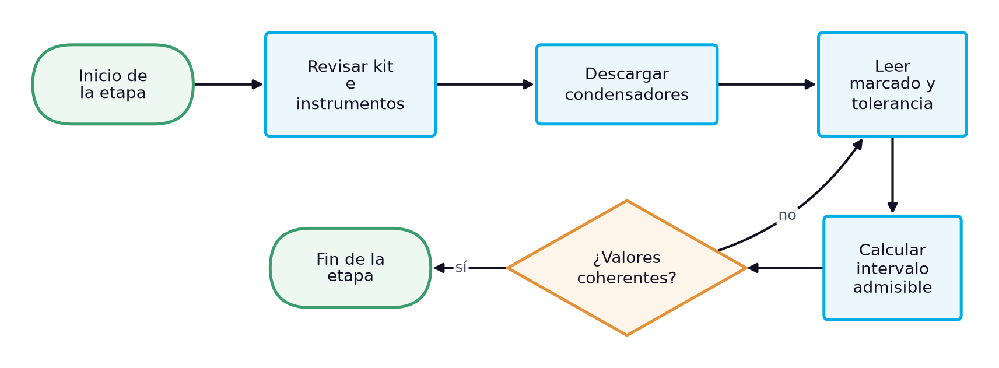
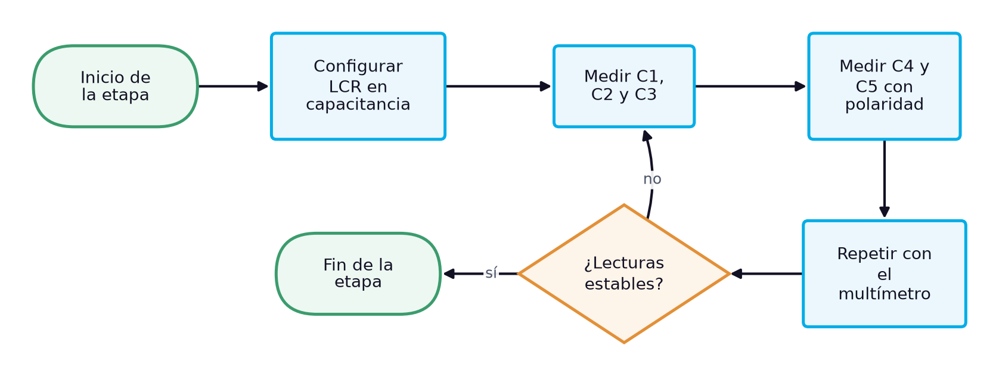
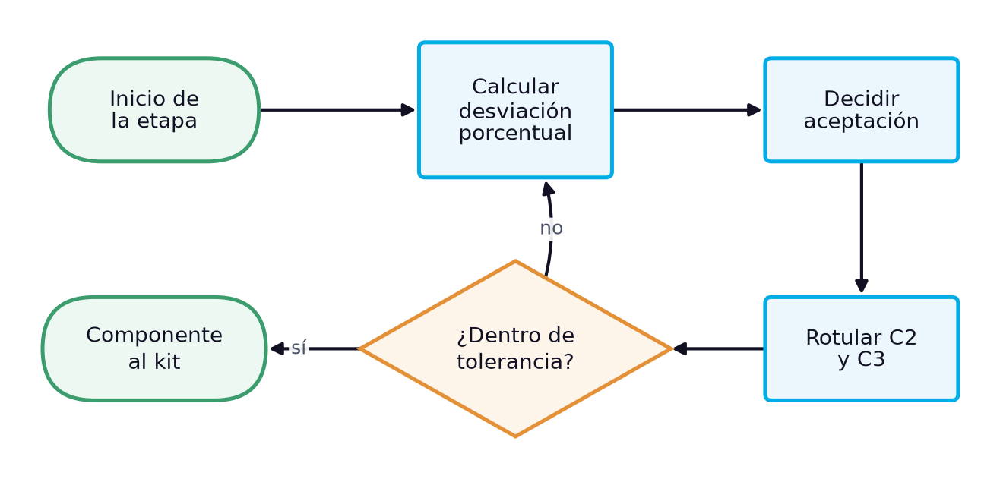

# Guía de laboratorio: Identificación y medición de la capacitancia de condensadores comerciales

> **Facultad:** Facultad de Ingenierías · **Módulo:** IEL04 — Circuitos Eléctricos I · **Docente:** Ing. Sergio Martinez Castilla
> **Semana:** 1 de 14 · **Resultado de aprendizaje:** [[IEL04-RA1]] · **Sesión:** [[IEL04-semana01]] · **Práctica:** propuesta a partir de la bibliografía [1] [2] · **Duración:** 240 minutos

Esta práctica lleva al banco el contenido de la sesión teórica de la semana 1, «El condensador: estructura, capacitancia, tipos e identificación de componentes comerciales», y reproduce su caso de estudio: identificar por su marcado los cinco condensadores del kit del grupo, calcular el intervalo que admite su tolerancia, medir su capacitancia real y decidir si cada uno puede usarse en las prácticas siguientes. No hay un manual de laboratorio asignado a este resultado de aprendizaje, por lo que la práctica se propone a partir de la bibliografía cargada: el texto de Floyd describe la verificación de un condensador con un medidor LCR o con la función de capacitancia del multímetro [1], y Boylestad, los esquemas de rotulado de los condensadores pequeños y las letras de tolerancia [2]. La práctica desarrolla los criterios de medición del RA IEL04-RA1 en circuitos capacitivos y deja registradas las capacitancias reales de los condensadores que formarán, con las bobinas de la semana 2, los circuitos LC de la semana 3.

## 1. Objetivos

**Objetivo general:** Verificar experimentalmente la capacitancia de condensadores comerciales a partir de su marcado y de la medición con instrumentos.

**Objetivos específicos:**

- Identificar el tipo, el valor nominal, la tolerancia y la tensión de trabajo de cinco condensadores a partir de su marcado. *(CE1)*
- Medir la capacitancia de cada condensador con el medidor LCR y con el multímetro, y calcular su desviación respecto del valor nominal. *(CE2)*
- Registrar la capacitancia real de los condensadores C2 y C3, que formarán el circuito LC de la semana 3, y estimar con ella su frecuencia de resonancia. *(CE3)*

## 2. Materiales y Equipos

| # | Material o equipo | Especificación | Cantidad |
|---|---|---|---|
| 1 | Kit de condensadores del grupo | C1 223J, C2 104K 100V, C3 472K, C4 470 µF 25 V, C5 100 µF 16 V | 1 |
| 2 | Medidor LCR | — | 1 |
| 3 | Multímetro digital con función de capacitancia | — | 1 |
| 4 | Resistencia de descarga | 1 kΩ | 1 |
| 5 | Cables con pinzas de cocodrilo aisladas | — | 4 |
| 6 | Lupa o lente de aumento para leer el marcado | — | 1 |
| 7 | Gafas de seguridad | — | 3 |

## 3. Procedimiento

La práctica ocupa el bloque de 2 h de laboratorio de la sesión y se realiza en grupos de tres estudiantes, con tres roles que rotan entre etapas: quien monta y opera el circuito, quien mide y quien registra y verifica los cálculos. Antes de energizar cualquier montaje, el docente o el monitor revisa la conexión. Cada etapa abre con su diagrama de flujo, que muestra la secuencia y las comprobaciones de un vistazo, y sigue con sus pasos numerados; cada paso indica cuánto dura, qué debe observarse para saber que salió bien y qué hacer si no. Los valores numéricos de la sesión teórica sirven de referencia: las lecturas propias del grupo se registran en las tablas de la sección de análisis.

### 3.1 Preparación e identificación (33 min)

*Figura 1. Diagrama de flujo de la etapa 1: Preparación e identificación*

1. Revisar que el kit contenga los cinco condensadores y que el medidor LCR y el multímetro enciendan y tengan batería suficiente. *(≈ 5 min)* **Comprobación:** Los dos instrumentos deben mostrar lectura estable con las puntas abiertas; si no, solicitar otro instrumento.
2. Descargar el condensador conectando entre sus terminales, durante unos segundos, una resistencia de 1 kΩ sujeta con pinzas aisladas, y medir con el voltímetro en cd la tensión entre terminales. *(≈ 3 min)* **Comprobación:** La tensión debe ser prácticamente nula (menos de 0,1 V); si no lo es, repetir la descarga antes de manipular el componente. **Seguridad:** No cortocircuitar los terminales con los dedos ni con una herramienta metálica: un condensador puede conservar carga después de desconectado.
3. Leer el marcado de cada condensador y anotar en la tabla de registro su tipo, su valor nominal (convertido a nF o µF), su tolerancia y su tensión de trabajo, usando el código de tres dígitos y las letras J (±5 %) y K (±10 %) [2]. *(≈ 15 min)* **Comprobación:** Para C1 debe obtenerse 22 nF ±5 %; si el valor no coincide, repasar la regla del tercer dígito como número de ceros en pF.
4. Calcular para cada condensador el intervalo admisible $C_{\min} = C_n(1-t)$ a $C_{\max} = C_n(1+t)$. *(≈ 10 min)* **Comprobación:** Para C1 el intervalo es de 20,9 nF a 23,1 nF; si el resultado difiere, revisar la conversión de unidades.

### 3.2 Medición de la capacitancia (40 min)

*Figura 2. Diagrama de flujo de la etapa 2: Medición de la capacitancia*

5. Ajustar el medidor LCR en la función de capacitancia y conectar C1 entre sus terminales; anotar la lectura en la misma unidad del valor nominal [1]. *(≈ 8 min)* **Comprobación:** La lectura debe estabilizarse en pocos segundos; si oscila, revisar el contacto de las pinzas.
6. Repetir la medición con C2 y C3 y anotar las lecturas. *(≈ 10 min)* **Comprobación:** Las lecturas deben estar en el orden de magnitud del nominal (nF); una lectura nula o en pF indica un contacto abierto.
7. Medir C4 y C5 conectando el terminal positivo del electrolítico al terminal positivo del instrumento [2]. *(≈ 10 min)* **Comprobación:** Comprobar la marca de polaridad antes de conectar; si el instrumento indica sobrecarga, revisar la escala. **Seguridad:** Respetar la polaridad de los electrolíticos y no superar su tensión de trabajo.
8. Medir de nuevo los cinco condensadores con la función de capacitancia del multímetro y anotar ambas lecturas. *(≈ 12 min)* **Comprobación:** Las dos lecturas de un mismo condensador deben diferir menos que la tolerancia; si no, repetir la medición con el LCR.

### 3.3 Decisión y registro para el circuito LC (22 min)

*Figura 3. Diagrama de flujo de la etapa 3: Decisión y registro para el circuito LC*

9. Calcular la desviación $e_{\%} = (C_m - C_n)/C_n \times 100$ de cada condensador y decidir si se acepta (|e| no supera la tolerancia). *(≈ 12 min)* **Comprobación:** Un condensador fuera de su intervalo se rechaza y se marca; se informa al docente para reponerlo.
10. Rotular C2 y C3 con su capacitancia medida y calcular con ella y con L = 10 mH la frecuencia de resonancia $f_r = 1/(2\pi\sqrt{LC})$ que se medirá en la semana 3. *(≈ 10 min)* **Comprobación:** Con los valores nominales se obtiene unos 5,03 kHz para C2; un resultado muy distinto indica un error de unidades.

### 3.4 Desmontaje y cierre (10 min)

*Figura 4. Diagrama de flujo de la etapa 4: Desmontaje y cierre*

11. Apagar el generador de funciones y la fuente, desconectar las puntas del osciloscopio y retirar la alimentación del protoboard. *(≈ 3 min)* **Comprobación:** Ningún indicador de salida debe quedar encendido en el generador ni en la fuente. **Seguridad:** Desenergizar siempre antes de retirar componentes.
12. Descargar los condensadores del montaje con la resistencia de descarga, retirar los componentes y devolverlos al kit del grupo con su rótulo. *(≈ 4 min)* **Comprobación:** El kit debe quedar completo, con cada componente en su lugar y con su valor medido anotado.
13. Revisar con el docente las tablas de registro antes de abandonar el banco. *(≈ 3 min)* **Comprobación:** Las tablas deben estar completas y con unidades; si falta un dato, repetir esa medición antes de desmontar el instrumento.

## 4. Cuestiones a Resolver

1. ¿Qué condensadores quedaron fuera de su intervalo de tolerancia y qué explicación física ofrece la sesión teórica para cada caso?
2. ¿En cuánto difieren las lecturas del medidor LCR y del multímetro para un mismo condensador, y cuál de los dos instrumentos es más adecuado para valores de pocos nanofaradios?
3. ¿Por qué el rótulo «104» corresponde a 100 nF y no a 104 pF?
4. Con la capacitancia medida de C2, ¿cuánto cambia la frecuencia de resonancia prevista respecto de la calculada con el valor nominal?

## 5. Análisis de Resultados

Completar la tabla de identificación con el valor nominal, la tolerancia, el intervalo admisible, las dos lecturas y la desviación porcentual de cada condensador, usando la misma unidad del valor nominal en cada fila.

Representar en un gráfico de barras la desviación porcentual de cada condensador junto con su tolerancia, de modo que se vea de un vistazo cuáles se aceptan; discutir si las desviaciones observadas son coherentes con el tipo de dieléctrico, como describe la sesión teórica.

**Tabla 1.** Identificación y medición de los condensadores del kit

| Ref. | Marcado | Cn (nF o µF) | Tolerancia (%) | Cm LCR (nF o µF) | Cm multímetro (nF o µF) | e (%) |
|---|---|---|---|---|---|---|
|   |   |   |   |   |   |   |
|   |   |   |   |   |   |   |
|   |   |   |   |   |   |   |
|   |   |   |   |   |   |   |
|   |   |   |   |   |   |   |

**Tabla 2.** Frecuencia de resonancia prevista para la semana 3

| Condensador | C medida (nF) | L supuesta (mH) | fr con nominales (kHz) | fr con medida (kHz) |
|---|---|---|---|---|
|   |   |   |   |   |
|   |   |   |   |   |

## 6. Conclusiones

Contrastar el valor medido de cada condensador con su intervalo de tolerancia y justificar la decisión de aceptarlo o rechazarlo; explicar las desviaciones con los mecanismos vistos en la sesión (envejecimiento del dieléctrico, secado del electrolito, rotulado incorrecto) y relacionar la práctica con el criterio de medición en circuitos capacitivos del RA.

- ¿Qué condensador mostró la mayor desviación y qué la explica?
- ¿Por qué conviene usar en los cálculos de las semanas siguientes los valores medidos y no los nominales?
- ¿Qué precaución resultó indispensable al medir los electrolíticos?

## 7. Recomendaciones de Seguridad

- Trabajar con el circuito desenergizado mientras se conecta o modifica el montaje; energizar solo después de la revisión del docente.
- Descargar los condensadores con una resistencia antes de manipularlos o medirlos, y respetar la polaridad de los electrolíticos: conectado con la polaridad invertida, un electrolítico puede explotar y provocar lesiones [1].
- Usar gafas de seguridad al medir y manipular los electrolíticos C4 y C5.
- Sujetar los condensadores con pinzas aisladas al descargarlos y no doblar en exceso sus terminales.

## 8. Bibliografía

[1] Floyd, Thomas L., *Principios de circuitos eléctricos*, 8.ª ed., Pearson Educación, 2007.

[2] Boylestad, Robert L., *Introducción al análisis de circuitos*, 10.ª ed., Pearson Educación, 2004.
