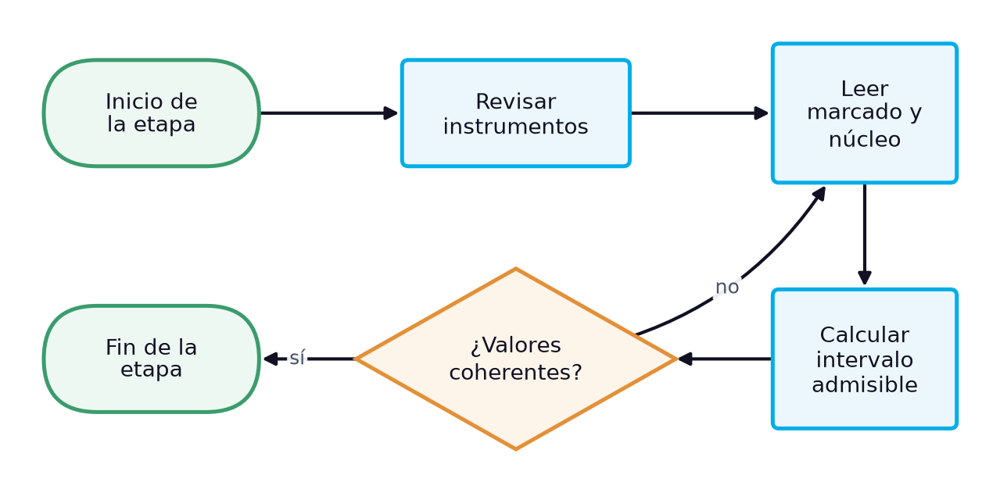
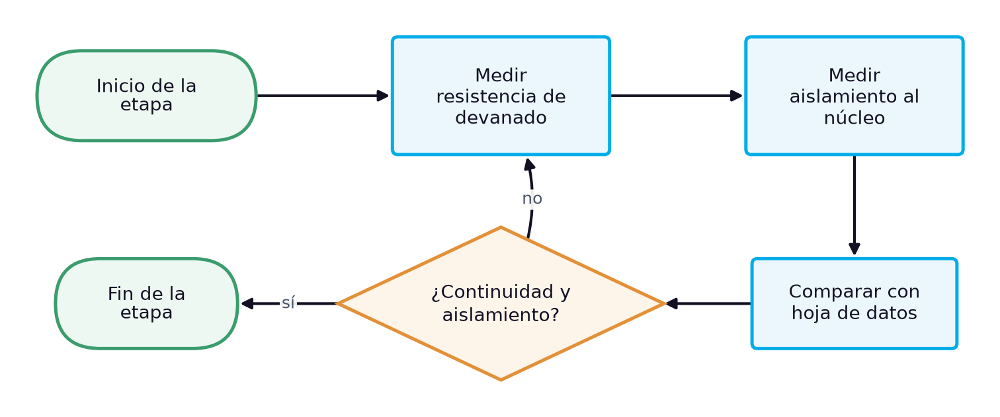
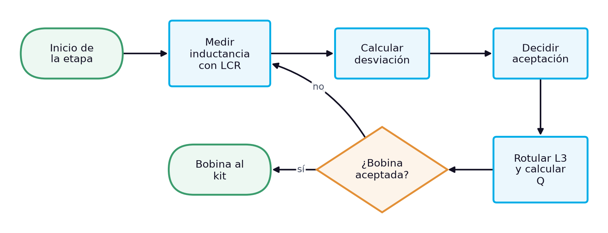

# Guía de laboratorio: Identificación y verificación de bobinas: inductancia, resistencia de devanado y aislamiento

> **Facultad:** Facultad de Ingenierías · **Módulo:** IEL04 — Circuitos Eléctricos I · **Docente:** Ing. Sergio Martinez Castilla
> **Semana:** 2 de 14 · **Resultado de aprendizaje:** [[IEL04-RA1]] · **Sesión:** [[IEL04-semana02]] · **Práctica:** propuesta a partir de la bibliografía [1] [2] · **Duración:** 240 minutos

La práctica corresponde a la sesión teórica de la semana 2, «La bobina: inductancia, inducción electromagnética, tipos de núcleo e identificación de inductores», y reproduce su caso de estudio: verificar las cuatro bobinas del kit del grupo midiendo su inductancia, su resistencia de devanado y, en las de núcleo metálico, su aislamiento respecto del núcleo. No hay un manual de laboratorio asignado al RA IEL04-RA1, así que la práctica se propone a partir de la bibliografía cargada: Boylestad indica que un devanado abierto se detecta con el ohmímetro, que marca una resistencia infinita, y describe los valores estándar y las tolerancias de los inductores [2]; Floyd presenta la construcción y los tipos de inductores [1]. Las bobinas aceptadas, con su inductancia y su resistencia de devanado medidas, se usarán en los circuitos LC de la semana 3 y en los circuitos RL y RLC del resto del semestre.

## 1. Objetivos

**Objetivo general:** Verificar experimentalmente el estado de las bobinas del kit mediante la medición de su inductancia, su resistencia de devanado y su aislamiento.

**Objetivos específicos:**

- Identificar el tipo de núcleo, el valor nominal y la tolerancia de cuatro bobinas a partir de su marcado. *(CE1)*
- Medir la inductancia con el medidor LCR y la resistencia de devanado con el ohmímetro, y comprobar el aislamiento entre devanado y núcleo. *(CE2)*
- Registrar la inductancia y la resistencia de devanado de la bobina L3, que formará el circuito LC de la semana 3, y estimar su factor de calidad a la frecuencia de resonancia prevista. *(CE3)*

## 2. Materiales y Equipos

| # | Material o equipo | Especificación | Cantidad |
|---|---|---|---|
| 1 | Kit de bobinas del grupo | L1 102J, L2 472K, L3 103K (núcleo de ferrita), L4 33 mH ±20 % (toroidal) | 1 |
| 2 | Medidor LCR | — | 1 |
| 3 | Multímetro digital (ohmímetro) | — | 1 |
| 4 | Cables con pinzas de cocodrilo aisladas | — | 4 |
| 5 | Lupa o lente de aumento para leer el marcado | — | 1 |

## 3. Procedimiento

La práctica ocupa el bloque de 2 h de laboratorio de la sesión y se realiza en grupos de tres estudiantes, con tres roles que rotan entre etapas: quien monta y opera el circuito, quien mide y quien registra y verifica los cálculos. Antes de energizar cualquier montaje, el docente o el monitor revisa la conexión. Cada etapa abre con su diagrama de flujo, que muestra la secuencia y las comprobaciones de un vistazo, y sigue con sus pasos numerados; cada paso indica cuánto dura, qué debe observarse para saber que salió bien y qué hacer si no. Los valores numéricos de la sesión teórica sirven de referencia: las lecturas propias del grupo se registran en las tablas de la sección de análisis.

### 3.1 Preparación e identificación (28 min)

*Figura 1. Diagrama de flujo de la etapa 1: Preparación e identificación*

1. Verificar que las bobinas estén desconectadas de cualquier circuito y que el medidor LCR y el ohmímetro funcionen. *(≈ 5 min)* **Comprobación:** Con las puntas del ohmímetro unidas, la lectura debe ser cercana a 0 Ω; si no, anotar ese valor para restarlo después.
2. Leer el marcado de cada bobina, convertir su valor nominal a mH (el código de tres dígitos se expresa en µH) y anotar la tolerancia y el tipo de núcleo [FUENTE NO CARGADA EN raw/]. *(≈ 15 min)* **Comprobación:** Para L1 (102J) debe obtenerse 1 mH ±5 %; si el valor difiere, revisar que la base del código sea el microhenrio.
3. Calcular el intervalo admisible de inductancia de cada bobina a partir de su tolerancia. *(≈ 8 min)* **Comprobación:** Para L2 (472K) el intervalo es de 4,23 mH a 5,17 mH.

### 3.2 Medición de continuidad, resistencia y aislamiento (26 min)

*Figura 2. Diagrama de flujo de la etapa 2: Medición de continuidad, resistencia y aislamiento*

4. Medir con el ohmímetro la resistencia de devanado de cada bobina y anotarla [2]. *(≈ 12 min)* **Comprobación:** Una lectura infinita indica devanado abierto y la bobina se rechaza; una lectura de pocos ohmios es normal.
5. En L3 y L4, medir la resistencia entre un terminal del devanado y el núcleo o la carcasa metálica. *(≈ 8 min)* **Comprobación:** Debe leerse una resistencia muy alta (circuito abierto); una lectura cercana a 0 Ω indica un corto al núcleo.
6. Comparar la resistencia de devanado medida con la de la hoja de datos cuando se conoce (25 Ω para L3 y 18 Ω para L4). *(≈ 6 min)* **Comprobación:** Una resistencia claramente menor que la de la hoja sugiere espiras en corto y obliga a confirmar con la inductancia.

### 3.3 Medición de la inductancia y decisión (35 min)

*Figura 3. Diagrama de flujo de la etapa 3: Medición de la inductancia y decisión*

7. Configurar el medidor LCR en la función de inductancia, medir cada bobina y anotar la lectura en mH. *(≈ 15 min)* **Comprobación:** La lectura debe estar en el orden del nominal; si es mucho menor, sospechar espiras en corto.
8. Calcular la desviación $e_{\%} = (L_m - L_n)/L_n \times 100$ y decidir: la bobina se acepta si |e| no supera la tolerancia, tiene continuidad y está aislada del núcleo. *(≈ 10 min)* **Comprobación:** Una bobina con resistencia y con inductancia bajas a la vez se rechaza: ambas mediciones confirman el corto entre espiras.
9. Rotular L3 con su inductancia y su resistencia de devanado medidas y calcular su factor de calidad $Q = 2\pi f L / R_W$ a 5 kHz, la resonancia prevista con C2. *(≈ 10 min)* **Comprobación:** Con 10 mH y 25 Ω se obtiene Q del orden de 12 a 13; un valor muy distinto indica un error de unidades.

### 3.4 Desmontaje y cierre (7 min)

10. Descargar los condensadores del montaje con la resistencia de descarga, retirar los componentes y devolverlos al kit del grupo con su rótulo. *(≈ 4 min)* **Comprobación:** El kit debe quedar completo, con cada componente en su lugar y con su valor medido anotado.
11. Revisar con el docente las tablas de registro antes de abandonar el banco. *(≈ 3 min)* **Comprobación:** Las tablas deben estar completas y con unidades; si falta un dato, repetir esa medición antes de desmontar el instrumento.

## 4. Cuestiones a Resolver

1. ¿Por qué el ohmímetro por sí solo no basta para detectar un corto entre unas pocas espiras?
2. Si la inductancia es proporcional al cuadrado del número de vueltas, ¿qué fracción de las espiras habría perdido una bobina cuya inductancia cayó al 65 % de su valor?
3. ¿Qué papel tendrá la resistencia de devanado medida en los circuitos inductivos y LC de las semanas siguientes?
4. ¿Qué diferencias se observaron entre las bobinas de núcleo de aire o ferrita y la toroidal?

## 5. Análisis de Resultados

Completar la tabla de verificación con el valor nominal, el intervalo admisible, la inductancia medida, la desviación, la resistencia de devanado y el resultado del aislamiento de cada bobina, y justificar la decisión de aceptación de cada una combinando las mediciones.

Calcular el factor de calidad de L3 a 5 kHz con su inductancia y su resistencia de devanado medidas, y comentar qué indica ese valor sobre lo cerca que estará la bobina real de comportarse como una inductancia ideal en el circuito LC.

**Tabla 1.** Verificación de las bobinas del kit

| Ref. | Ln (mH) | Intervalo (mH) | Lm (mH) | e (%) | RW medida (Ω) | Aislamiento |
|---|---|---|---|---|---|---|
|   |   |   |   |   |   |   |
|   |   |   |   |   |   |   |
|   |   |   |   |   |   |   |
|   |   |   |   |   |   |   |

## 6. Conclusiones

Concluir, para cada bobina, si es apta para las prácticas siguientes, apoyando la decisión en la combinación de la inductancia, la resistencia de devanado y el aislamiento; explicar por qué una sola medición puede no ser concluyente y relacionar la práctica con los criterios de medición del RA en circuitos inductivos.

- ¿Qué bobina fue rechazada y qué mediciones lo demostraron?
- ¿Qué valor de la bobina L3 se usará en adelante y por qué?
- ¿Qué limitación del ohmímetro quedó en evidencia?

## 7. Recomendaciones de Seguridad

- Medir siempre con las bobinas desconectadas de cualquier fuente: el ohmímetro y el medidor LCR no deben conectarse a un circuito energizado.
- No desconectar bruscamente una bobina por la que circula corriente: la tensión inducida al interrumpirla puede producir una chispa entre los contactos.
- Manipular con cuidado las bobinas toroidales y de ferrita: el núcleo es frágil y una fisura altera la inductancia.

## 8. Bibliografía

[1] Floyd, Thomas L., *Principios de circuitos eléctricos*, 8.ª ed., Pearson Educación, 2007.

[2] Boylestad, Robert L., *Introducción al análisis de circuitos*, 10.ª ed., Pearson Educación, 2004.

[3] *Hoja de datos del fabricante de los inductores del kit de laboratorio (código de colores y código de tres dígitos)*. [FUENTE NO CARGADA EN raw/]
