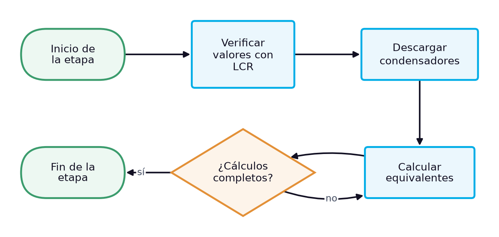
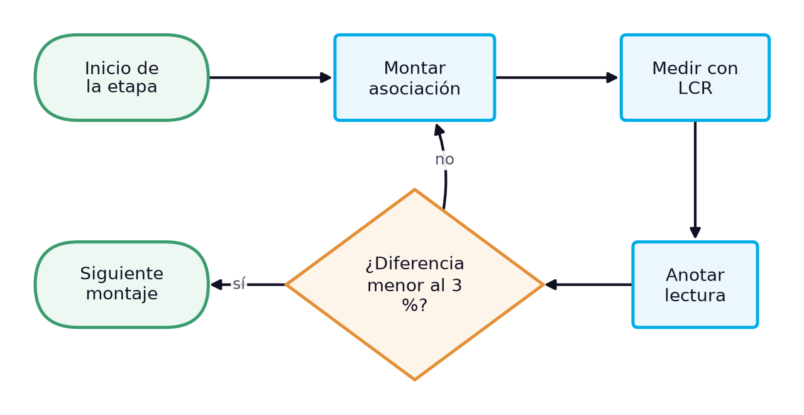
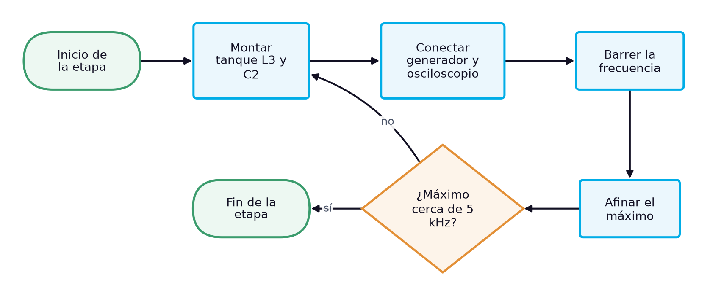

# Guía de laboratorio: Asociaciones de condensadores y bobinas, y medición de la frecuencia de resonancia de un circuito LC

> **Facultad:** Facultad de Ingenierías · **Módulo:** IEL04 — Circuitos Eléctricos I · **Docente:** Ing. Sergio Martinez Castilla
> **Semana:** 3 de 14 · **Resultado de aprendizaje:** [[IEL04-RA1]] · **Sesión:** [[IEL04-semana03]] · **Práctica:** propuesta a partir de la bibliografía [1] [2] · **Duración:** 240 minutos

La práctica cierra el RA IEL04-RA1 y corresponde a la sesión teórica de la semana 3, «Asociaciones de condensadores y bobinas en serie, en paralelo y mixtas: cálculo y medición en circuitos L, C y LC». Reproduce su caso de estudio con los componentes aceptados en las semanas 1 y 2: se miden con el medidor LCR cinco asociaciones (dos de condensadores y tres de bobinas) y se compara cada lectura con el valor calculado con los valores medidos de los componentes; después se forma un circuito tanque con L3 y C2 y se busca con el osciloscopio su frecuencia de resonancia. Sin un manual de laboratorio asignado, la práctica se propone a partir de la bibliografía: las reglas de asociación de inductores en serie y en paralelo son análogas a las de los resistores y los condensadores [1], y en un circuito resonante en paralelo la impedancia es máxima a la frecuencia de resonancia [1]; Boylestad trata la combinación de capacitores e inductores [2].

## 1. Objetivos

**Objetivo general:** Comprobar experimentalmente las reglas de asociación de condensadores y bobinas y la frecuencia de resonancia de un circuito LC.

**Objetivos específicos:**

- Identificar los componentes de cada montaje con su valor medido en las semanas 1 y 2. *(CE1)*
- Medir con el medidor LCR la capacitancia y la inductancia equivalentes de cinco asociaciones en serie, en paralelo y mixtas, y compararlas con el cálculo. *(CE2)*
- Medir con el osciloscopio la frecuencia de resonancia de un circuito tanque formado por L3 y C2 y compararla con la calculada. *(CE3)*

## 2. Materiales y Equipos

| # | Material o equipo | Especificación | Cantidad |
|---|---|---|---|
| 1 | Condensadores verificados | C1 (223J), C2 (104K), C3 (472K) | 1 |
| 2 | Bobinas verificadas | L1 (102J), L2 (472K), L3 (103K) | 1 |
| 3 | Resistor | 10 kΩ | 1 |
| 4 | Medidor LCR | — | 1 |
| 5 | Generador de funciones | — | 1 |
| 6 | Osciloscopio de dos canales con puntas ×10 | — | 1 |
| 7 | Protoboard | — | 1 |
| 8 | Cables de conexión | — | 10 |
| 9 | Resistencia de descarga | 1 kΩ | 1 |

## 3. Procedimiento

La práctica ocupa el bloque de 2 h de laboratorio de la sesión y se realiza en grupos de tres estudiantes, con tres roles que rotan entre etapas: quien monta y opera el circuito, quien mide y quien registra y verifica los cálculos. Antes de energizar cualquier montaje, el docente o el monitor revisa la conexión. Cada etapa abre con su diagrama de flujo, que muestra la secuencia y las comprobaciones de un vistazo, y sigue con sus pasos numerados; cada paso indica cuánto dura, qué debe observarse para saber que salió bien y qué hacer si no. Los valores numéricos de la sesión teórica sirven de referencia: las lecturas propias del grupo se registran en las tablas de la sección de análisis.

### 3.1 Preparación y cálculo previo (23 min)

*Figura 1. Diagrama de flujo de la etapa 1: Preparación y cálculo previo*

1. Verificar con el medidor LCR que los valores de C1, C2, C3, L1, L2 y L3 coincidan con los registrados en las semanas 1 y 2. *(≈ 8 min)* **Comprobación:** Las lecturas deben coincidir con las anotadas dentro del 1 %; si no, usar el valor nuevo en los cálculos.
2. Descargar el condensador conectando entre sus terminales, durante unos segundos, una resistencia de 1 kΩ sujeta con pinzas aisladas, y medir con el voltímetro en cd la tensión entre terminales. *(≈ 3 min)* **Comprobación:** La tensión debe ser prácticamente nula (menos de 0,1 V); si no lo es, repetir la descarga antes de manipular el componente. **Seguridad:** No cortocircuitar los terminales con los dedos ni con una herramienta metálica: un condensador puede conservar carga después de desconectado.
3. Calcular con los valores medidos el equivalente de cada montaje: A (C1 en serie con C3), B (C1 en paralelo con C2), C (L1 en serie con L2), D (L2 en paralelo con L3) y E ((L1 + L2) en paralelo con L3). *(≈ 12 min)* **Comprobación:** Para el montaje B debe obtenerse unos 120 nF; para el C, unos 5,65 mH.

### 3.2 Medición de las asociaciones (33 min)

*Figura 2. Diagrama de flujo de la etapa 2: Medición de las asociaciones*

4. Montar en el protoboard el montaje A, medir su capacitancia equivalente con el LCR y anotarla. *(≈ 7 min)* **Comprobación:** La lectura debe ser menor que la del menor condensador (C3); si es mayor, revisar que estén en serie.
5. Montar el montaje B y medir su capacitancia equivalente. *(≈ 6 min)* **Comprobación:** La lectura debe ser cercana a la suma de C1 y C2.
6. Montar el montaje C y medir su inductancia equivalente. *(≈ 6 min)* **Comprobación:** La lectura debe ser cercana a la suma de L1 y L2.
7. Montar el montaje D con las bobinas separadas y sus ejes perpendiculares, y medir su inductancia equivalente. *(≈ 7 min)* **Comprobación:** La lectura debe ser menor que la de L2; si difiere mucho del cálculo, alejar más las bobinas para reducir el acoplamiento.
8. Montar el montaje E y medir su inductancia equivalente. *(≈ 7 min)* **Comprobación:** La lectura debe estar a menos del 3 % del cálculo con valores medidos.

### 3.3 Resonancia del circuito LC (26 min)

*Figura 3. Diagrama de flujo de la etapa 3: Resonancia del circuito LC*

9. Montar L3 en paralelo con C2 y alimentar el conjunto desde el generador de funciones a través del resistor de 10 kΩ; conectar el canal 1 del osciloscopio a la salida del generador y el canal 2 sobre el tanque, con las puntas ×10 compensadas [1]. *(≈ 8 min)* **Comprobación:** Antes de energizar, el docente revisa el montaje; las dos tierras de las puntas van al mismo nodo de referencia. **Seguridad:** Energizar solo después de la revisión del docente.
10. Ajustar el generador a una onda sinusoidal de amplitud moderada y barrer la frecuencia entre 2 kHz y 10 kHz observando la amplitud en el tanque. *(≈ 10 min)* **Comprobación:** La tensión en el tanque debe pasar por un máximo cerca de 5 kHz; si no aparece, revisar las conexiones del tanque.
11. Afinar la frecuencia del máximo de tensión en el tanque, leerla en el generador y con los cursores del osciloscopio, y anotarla. *(≈ 8 min)* **Comprobación:** El valor debe estar a pocos por ciento de la $f_r = 1/(2\pi\sqrt{LC})$ calculada con L3 y C2 medidos (unos 4,99 kHz).

### 3.4 Desmontaje y cierre (10 min)

*Figura 4. Diagrama de flujo de la etapa 4: Desmontaje y cierre*

12. Apagar el generador de funciones y la fuente, desconectar las puntas del osciloscopio y retirar la alimentación del protoboard. *(≈ 3 min)* **Comprobación:** Ningún indicador de salida debe quedar encendido en el generador ni en la fuente. **Seguridad:** Desenergizar siempre antes de retirar componentes.
13. Descargar los condensadores del montaje con la resistencia de descarga, retirar los componentes y devolverlos al kit del grupo con su rótulo. *(≈ 4 min)* **Comprobación:** El kit debe quedar completo, con cada componente en su lugar y con su valor medido anotado.
14. Revisar con el docente las tablas de registro antes de abandonar el banco. *(≈ 3 min)* **Comprobación:** Las tablas deben estar completas y con unidades; si falta un dato, repetir esa medición antes de desmontar el instrumento.

## 4. Cuestiones a Resolver

1. ¿Por qué la capacitancia equivalente de dos condensadores en serie es menor que la del menor de ellos?
2. ¿Cuánto se apartaron las lecturas del cálculo con valores nominales y cuánto del cálculo con valores medidos? ¿Qué indica la diferencia?
3. ¿Qué efecto tendría acercar las bobinas del montaje D con sus ejes alineados?
4. ¿Por qué la tensión en el tanque es máxima en la resonancia? Relacionarlo con la impedancia del circuito resonante en paralelo.
5. ¿Qué componentes del montaje, además de L3 y C2, pueden desplazar la frecuencia de resonancia medida?

## 5. Análisis de Resultados

Para cada montaje, calcular la diferencia porcentual $e_{\%} = (X_{med} - X_{calc})/X_{calc} \times 100$ entre la lectura del LCR y el valor calculado con los valores medidos de los componentes, y presentar ambos cálculos (nominal y con medidos) junto a la lectura.

Calcular la frecuencia de resonancia con los valores medidos de L3 y C2, compararla con la medida y expresar la diferencia porcentual; discutir el efecto de la capacitancia de las puntas y del cableado.

**Tabla 1.** Valores equivalentes calculados y medidos

| Montaje | Asociación | Calc. nominal (nF o mH) | Calc. con medidos (nF o mH) | Medido LCR (nF o mH) | e (%) |
|---|---|---|---|---|---|
|   |   |   |   |   |   |
|   |   |   |   |   |   |
|   |   |   |   |   |   |
|   |   |   |   |   |   |
|   |   |   |   |   |   |

**Tabla 2.** Frecuencia de resonancia del tanque L3 ∥ C2

| L3 medida (mH) | C2 medida (nF) | fr calculada (kHz) | fr medida (kHz) | Diferencia (%) |
|---|---|---|---|---|
|   |   |   |   |   |
|   |   |   |   |   |

## 6. Conclusiones

Concluir si las reglas de asociación se cumplen dentro de la exactitud de los instrumentos, comparando el ajuste del cálculo con valores nominales y con valores medidos; explicar la diferencia entre la resonancia calculada y la medida y relacionar la práctica con los criterios de medición en circuitos capacitivos, inductivos y LC del RA.

- ¿Qué cálculo predijo mejor las lecturas y por qué?
- ¿Qué tan cerca estuvo la resonancia medida de la calculada?
- ¿Qué cuidado del montaje resultó más importante para obtener buenas mediciones?

## 7. Recomendaciones de Seguridad

- Trabajar con el circuito desenergizado mientras se conecta o modifica el montaje; energizar solo después de la revisión del docente.
- Descargar los condensadores con una resistencia antes de manipularlos o medirlos, y respetar la polaridad de los electrolíticos: conectado con la polaridad invertida, un electrolítico puede explotar y provocar lesiones [1].
- Conectar las tierras de las dos puntas del osciloscopio al mismo nodo de referencia para no cortocircuitar parte del circuito.
- Mantener la amplitud del generador en valores moderados durante el barrido: en la resonancia la tensión en el tanque aumenta.

## 8. Bibliografía

[1] Floyd, Thomas L., *Principios de circuitos eléctricos*, 8.ª ed., Pearson Educación, 2007.

[2] Boylestad, Robert L., *Introducción al análisis de circuitos*, 10.ª ed., Pearson Educación, 2004.
