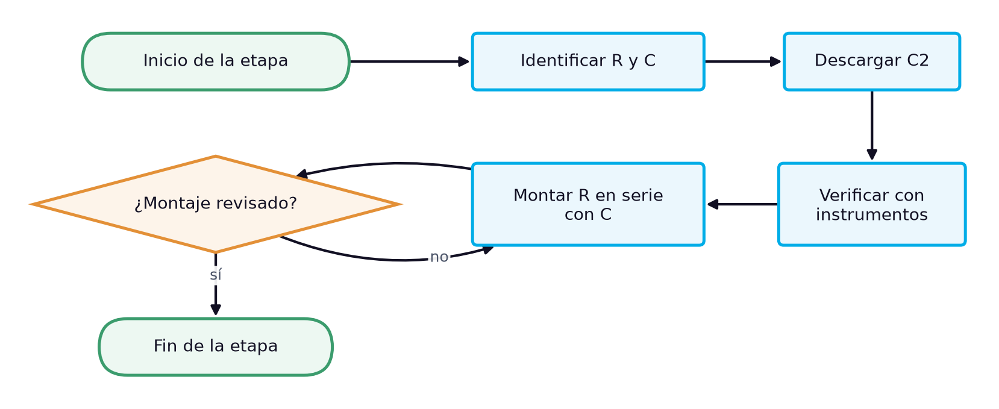
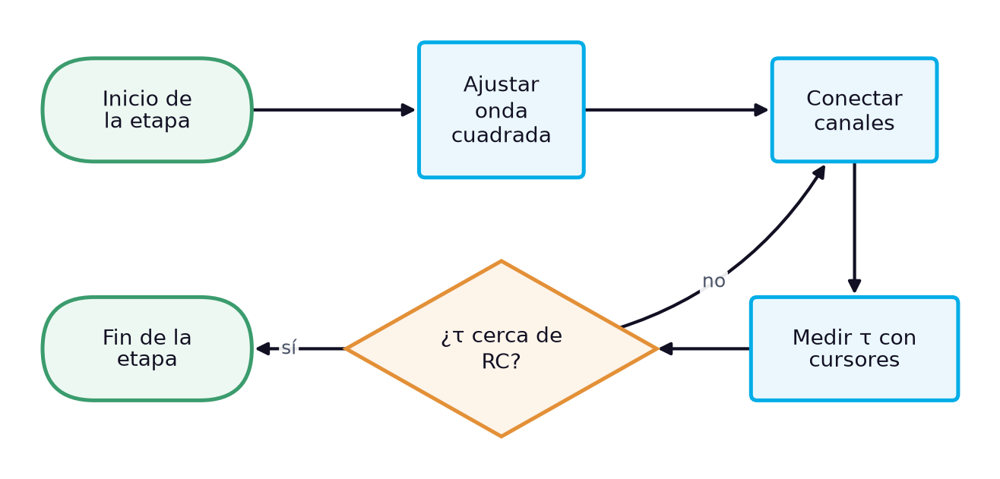
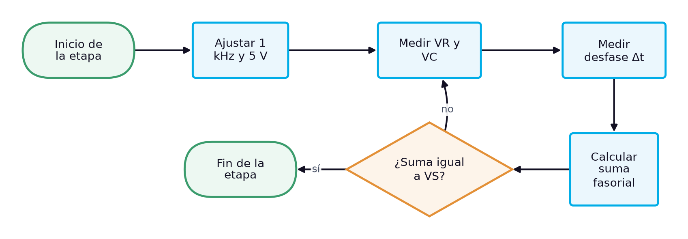
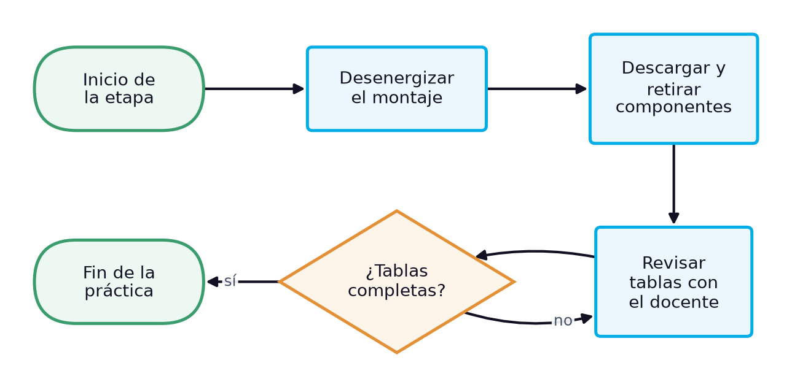

# Guía de laboratorio: Circuito RC en serie: constante de tiempo con onda cuadrada y ley de voltajes de Kirchhoff en régimen sinusoidal

> **Facultad:** Facultad de Ingenierías · **Módulo:** IEL04 — Circuitos Eléctricos I · **Docente:** Ing. Sergio Martinez Castilla
> **Semana:** 4 de 14 · **Resultado de aprendizaje:** [[IEL04-RA2]] · **Sesión:** [[IEL04-semana04]] · **Práctica:** propuesta a partir de la bibliografía [1] [2] [3] · **Duración:** 240 minutos

La práctica corresponde a la sesión teórica de la semana 4, «El circuito RC en serie: carga del condensador, reactancia capacitiva, impedancia y ley de voltajes de Kirchhoff», y reproduce su caso de estudio: con el resistor de 1,5 kΩ y el condensador C2 del kit se mide la constante de tiempo del circuito con una onda cuadrada y, con una señal sinusoidal de 1 kHz, las tensiones en el resistor y en el condensador, para verificar que su suma es fasorial y no aritmética. No hay un manual de laboratorio asignado al RA IEL04-RA2, por lo que la práctica se propone a partir de la bibliografía cargada: Floyd indica que para observar la carga y la descarga completas el semiperiodo de la onda cuadrada debe durar más de cinco constantes de tiempo y trata la ley de voltajes de Kirchhoff en circuitos RC [1]; Boylestad desarrolla los transitorios de carga y descarga [2] y Deorsola el régimen transitorio y la respuesta senoidal con fasores [3].

## 1. Objetivos

**Objetivo general:** Verificar experimentalmente la constante de tiempo y la ley de voltajes de Kirchhoff en un circuito RC en serie.

**Objetivos específicos:**

- Identificar por su marcado y verificar con instrumentos el resistor y el condensador del circuito. *(CE1)*
- Medir las tensiones del resistor y del condensador con el multímetro de verdadero valor eficaz en régimen sinusoidal. *(CE2)*
- Determinar experimentalmente la constante de tiempo y el ángulo de fase del circuito RC en serie con el osciloscopio, y comprobar la suma fasorial de tensiones. *(CE3)*

## 2. Materiales y Equipos

| # | Material o equipo | Especificación | Cantidad |
|---|---|---|---|
| 1 | Resistor de película | 1,5 kΩ ±5 % (marrón-verde-rojo-oro) | 1 |
| 2 | Condensador C2 del kit | 104K, 97,8 nF medidos | 1 |
| 3 | Generador de funciones | — | 1 |
| 4 | Osciloscopio de dos canales con puntas ×10 | — | 1 |
| 5 | Multímetro digital de verdadero valor eficaz | — | 2 |
| 6 | Medidor LCR | — | 1 |
| 7 | Protoboard | — | 1 |
| 8 | Cables de conexión | — | 12 |
| 9 | Resistencia de descarga | 1 kΩ | 1 |

## 3. Procedimiento

La práctica ocupa el bloque de 2 h de laboratorio de la sesión y se realiza en grupos de tres estudiantes, con tres roles que rotan entre etapas: quien monta y opera el circuito, quien mide y quien registra y verifica los cálculos. Antes de energizar cualquier montaje, el docente o el monitor revisa la conexión. Cada etapa abre con su diagrama de flujo, que muestra la secuencia y las comprobaciones de un vistazo, y sigue con sus pasos numerados; cada paso indica cuánto dura, qué debe observarse para saber que salió bien y qué hacer si no. Los valores numéricos de la sesión teórica sirven de referencia: las lecturas propias del grupo se registran en las tablas de la sección de análisis.

### 3.1 Preparación y montaje (19 min)

*Figura 1. Diagrama de flujo de la etapa 1: Preparación y montaje*

1. Identificar el resistor por su código de colores (marrón-verde-rojo-oro: 1,5 kΩ ±5 %) [1] y el condensador por su marcado (104K). *(≈ 4 min)* **Comprobación:** Si el código leído no da 1,5 kΩ, revisar el sentido de lectura empezando por la banda más cercana a un extremo.
2. Descargar el condensador conectando entre sus terminales, durante unos segundos, una resistencia de 1 kΩ sujeta con pinzas aisladas, y medir con el voltímetro en cd la tensión entre terminales. *(≈ 3 min)* **Comprobación:** La tensión debe ser prácticamente nula (menos de 0,1 V); si no lo es, repetir la descarga antes de manipular el componente. **Seguridad:** No cortocircuitar los terminales con los dedos ni con una herramienta metálica: un condensador puede conservar carga después de desconectado.
3. Verificar el resistor con el ohmímetro y el condensador C2 con el medidor LCR, y anotar sus valores medidos. *(≈ 6 min)* **Comprobación:** El resistor debe leer cerca de 1492 Ω y C2 cerca de 97,8 nF; si alguno sale de su tolerancia, reemplazarlo y anotar el nuevo valor.
4. Montar en el protoboard el resistor en serie con C2, con el condensador del lado de tierra. *(≈ 6 min)* **Comprobación:** El docente revisa el montaje antes de energizar. **Seguridad:** Montar con el generador apagado.

### 3.2 Constante de tiempo con onda cuadrada (19 min)

*Figura 2. Diagrama de flujo de la etapa 2: Constante de tiempo con onda cuadrada*

5. Ajustar el generador a una onda cuadrada de 0 V a 5 V y 500 Hz, de modo que el semiperiodo (1 ms) supere cinco constantes de tiempo (unos 750 µs) [1]. *(≈ 6 min)* **Comprobación:** En el canal 1 debe verse la onda cuadrada de 5 V; si no, revisar la configuración del generador.
6. Conectar el canal 1 a la salida del generador y el canal 2 sobre el condensador, con las puntas ×10 compensadas y las tierras en el mismo nodo. *(≈ 5 min)* **Comprobación:** En el canal 2 debe verse la curva exponencial de carga y descarga que llega a la meseta antes del flanco siguiente.
7. Medir con los cursores de tiempo el intervalo entre el flanco de subida y el instante en que $v_C$ alcanza el 63,2 % de su valor final; anotarlo como $\tau$ medida. *(≈ 8 min)* **Comprobación:** El valor debe estar cerca de $\tau = RC$ calculada con los valores medidos (unos 146 µs); si difiere más del 10 %, revisar la escala de tiempo.

### 3.3 Tensiones en régimen sinusoidal (29 min)

*Figura 3. Diagrama de flujo de la etapa 3: Tensiones en régimen sinusoidal*

8. Ajustar el generador a una onda sinusoidal de 1 kHz y medir con el osciloscopio y con el multímetro de verdadero valor eficaz que la tensión en los bornes del circuito, con el circuito conectado, sea de 5,00 V eficaces. *(≈ 6 min)* **Comprobación:** El multímetro debe indicar 5,00 V y el osciloscopio una sinusoide sin distorsión; si la tensión baja al conectar el circuito, reajustar la amplitud con el circuito conectado.
9. Medir con el multímetro de verdadero valor eficaz la tensión en el resistor y la tensión en el condensador, y anotarlas. *(≈ 8 min)* **Comprobación:** La suma aritmética de las dos lecturas debe superar 5 V; si da 5 V, revisar que el instrumento esté en ca.
10. Con el canal 1 en la salida del generador y el canal 2 en el resistor, medir el desfase de tiempo $\Delta t$ entre los cruces por cero y calcular $\theta = 360^\circ \times f \times \Delta t$. *(≈ 10 min)* **Comprobación:** El ángulo debe estar cerca de 47° de adelanto de la corriente; si sale mayor de 90°, revisar qué canal va adelantado.
11. Calcular $\sqrt{V_R^2 + V_C^2}$ con las lecturas y compararlo con la tensión de la fuente. *(≈ 5 min)* **Comprobación:** El resultado debe coincidir con 5,00 V a menos del 2 %; si no, repetir las lecturas de tensión.

### 3.4 Desmontaje y cierre (10 min)

*Figura 4. Diagrama de flujo de la etapa 4: Desmontaje y cierre*

12. Apagar el generador de funciones y la fuente, desconectar las puntas del osciloscopio y retirar la alimentación del protoboard. *(≈ 3 min)* **Comprobación:** Ningún indicador de salida debe quedar encendido en el generador ni en la fuente. **Seguridad:** Desenergizar siempre antes de retirar componentes.
13. Descargar los condensadores del montaje con la resistencia de descarga, retirar los componentes y devolverlos al kit del grupo con su rótulo. *(≈ 4 min)* **Comprobación:** El kit debe quedar completo, con cada componente en su lugar y con su valor medido anotado.
14. Revisar con el docente las tablas de registro antes de abandonar el banco. *(≈ 3 min)* **Comprobación:** Las tablas deben estar completas y con unidades; si falta un dato, repetir esa medición antes de desmontar el instrumento.

## 4. Cuestiones a Resolver

1. ¿Por qué el semiperiodo de la onda cuadrada debe superar cinco constantes de tiempo para medir τ?
2. ¿Qué diferencia porcentual hubo entre la τ medida y la calculada, y qué elementos del montaje la explican?
3. ¿Por qué la suma aritmética de VR y VC es mayor que la tensión de la fuente sin que se viole la ley de voltajes de Kirchhoff?
4. ¿Qué ángulo de fase se obtuvo y cómo se compara con $\arctan(X_C/R)$ calculado con los valores medidos?

## 5. Análisis de Resultados

Calcular con los valores medidos de R y C la constante de tiempo, la reactancia $X_C = 1/(2\pi f C)$, la impedancia $Z = \sqrt{R^2 + X_C^2}$, la corriente y las tensiones esperadas, y compararlas con las mediciones en la tabla de registro, con su diferencia porcentual.

Dibujar el diagrama fasorial de tensiones con las lecturas de VR y VC y el ángulo medido, y comprobar gráficamente que su suma vectorial reproduce la tensión de la fuente.

**Tabla 1.** Constante de tiempo del circuito RC en serie

| R medida (Ω) | C medida (nF) | τ calculada (µs) | τ medida (µs) | Diferencia (%) |
|---|---|---|---|---|
|   |   |   |   |   |
|   |   |   |   |   |
|   |   |   |   |   |

**Tabla 2.** Tensiones y ángulo a 1 kHz

| Magnitud | Calculado | Medido | Unidad | Diferencia (%) |
|---|---|---|---|---|
|   |   |   |   |   |
|   |   |   |   |   |
|   |   |   |   |   |
|   |   |   |   |   |
|   |   |   |   |   |
|   |   |   |   |   |

## 6. Conclusiones

Concluir si la constante de tiempo y las tensiones medidas concuerdan con el modelo del circuito RC en serie, explicando las diferencias con la resolución de los instrumentos y la resistencia interna del generador; relacionar la suma fasorial de tensiones con la ley de voltajes de Kirchhoff y con los criterios de medición del RA.

- ¿Qué tan bien coincidió τ medida con el producto RC?
- ¿Qué demuestra la diferencia entre la suma aritmética y la fasorial de las tensiones?
- ¿Qué paso del procedimiento fue más sensible a errores de lectura?

## 7. Recomendaciones de Seguridad

- Trabajar con el circuito desenergizado mientras se conecta o modifica el montaje; energizar solo después de la revisión del docente.
- Descargar los condensadores con una resistencia antes de manipularlos o medirlos, y respetar la polaridad de los electrolíticos: conectado con la polaridad invertida, un electrolítico puede explotar y provocar lesiones [1].
- Conectar las tierras de las dos puntas del osciloscopio a un mismo nodo de referencia: unirlas a nodos distintos cortocircuita el elemento que queda entre ellas.
- No superar la tensión de trabajo de C2 (100 V) ni la potencia del resistor; con 5 V de alimentación ambos trabajan holgados.

## 8. Bibliografía

[1] Floyd, Thomas L., *Principios de circuitos eléctricos*, 8.ª ed., Pearson Educación, 2007.

[2] Boylestad, Robert L., *Introducción al análisis de circuitos*, 10.ª ed., Pearson Educación, 2004.

[3] Deorsola, M. F. P., Morcelle del Valle, P., *Circuitos eléctricos. Parte 1*, 1.ª ed., Editorial de la Universidad de La Plata, 2017.
