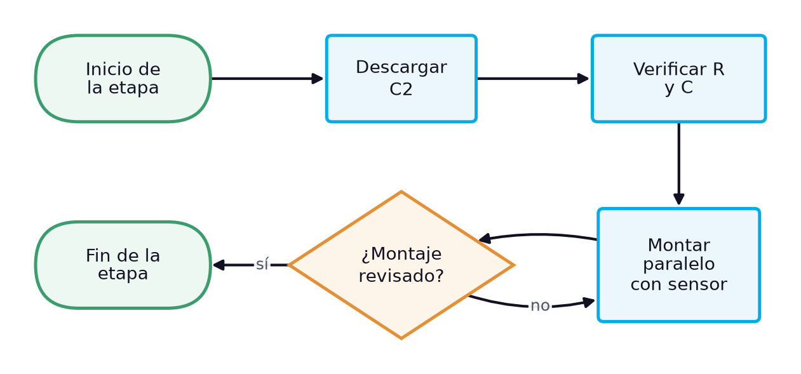
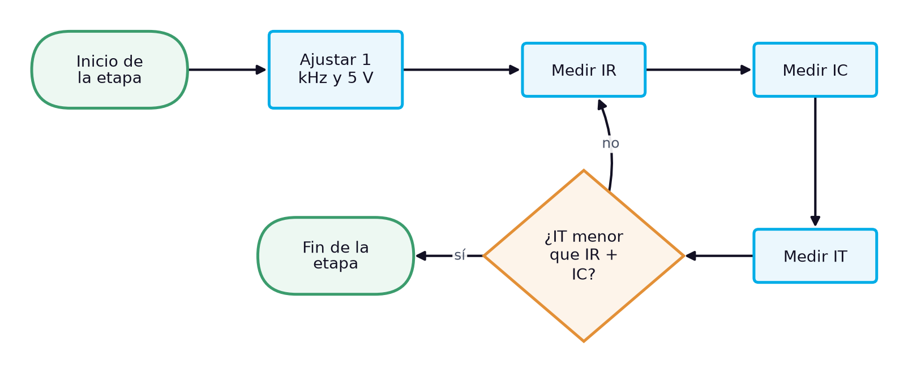
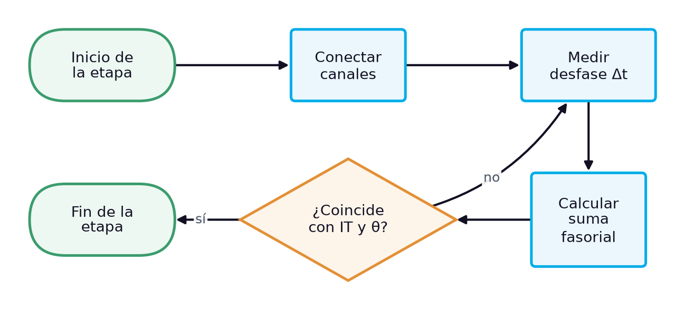

# Guía de laboratorio: Circuito RC en paralelo: corrientes de rama, corriente total y ley de corrientes de Kirchhoff

> **Facultad:** Facultad de Ingenierías · **Módulo:** IEL04 — Circuitos Eléctricos I · **Docente:** Ing. Sergio Martinez Castilla
> **Semana:** 6 de 14 · **Resultado de aprendizaje:** [[IEL04-RA2]] · **Sesión:** [[IEL04-semana06]] · **Práctica:** propuesta a partir de la bibliografía [1] [2] [3] · **Duración:** 240 minutos

La práctica corresponde a la sesión teórica de la semana 6, «El circuito RC en paralelo: admitancia, reparto de corrientes y ley de corrientes de Kirchhoff», y reproduce su caso de estudio con los mismos componentes de la semana 4 conectados en paralelo: se miden a 1 kHz la corriente de cada rama y la corriente total, y se comprueba que la corriente total es la suma fasorial de las corrientes de rama. No hay un manual de laboratorio asignado al RA IEL04-RA2, por lo que la práctica se propone a partir de la bibliografía cargada: Floyd trata la admitancia y el análisis de circuitos RC en paralelo y la ley de corrientes de Kirchhoff [1], Boylestad las redes de ca en paralelo [2] y Deorsola las leyes de Kirchhoff con fasores [3].

## 1. Objetivos

**Objetivo general:** Verificar experimentalmente la ley de corrientes de Kirchhoff y el ángulo de fase en un circuito RC en paralelo.

**Objetivos específicos:**

- Identificar y verificar con instrumentos el resistor y el condensador del circuito. *(CE1)*
- Medir con el multímetro la corriente de la rama resistiva y la de la rama capacitiva a 1 kHz. *(CE2)*
- Medir la corriente total y su desfase respecto de la tensión, y comprobar la suma fasorial de las corrientes de rama en el circuito RC en paralelo. *(CE3)*

## 2. Materiales y Equipos

| # | Material o equipo | Especificación | Cantidad |
|---|---|---|---|
| 1 | Resistor de película | 1,5 kΩ ±5 % | 1 |
| 2 | Condensador C2 del kit | 104K, 97,8 nF medidos | 1 |
| 3 | Resistor sensor de corriente | 10 Ω | 1 |
| 4 | Generador de funciones | — | 1 |
| 5 | Osciloscopio de dos canales con puntas ×10 | — | 1 |
| 6 | Multímetro digital de verdadero valor eficaz | — | 2 |
| 7 | Medidor LCR | — | 1 |
| 8 | Protoboard | — | 1 |
| 9 | Cables de conexión | — | 12 |
| 10 | Resistencia de descarga | 1 kΩ | 1 |

## 3. Procedimiento

La práctica ocupa el bloque de 2 h de laboratorio de la sesión y se realiza en grupos de tres estudiantes, con tres roles que rotan entre etapas: quien monta y opera el circuito, quien mide y quien registra y verifica los cálculos. Antes de energizar cualquier montaje, el docente o el monitor revisa la conexión. Cada etapa abre con su diagrama de flujo, que muestra la secuencia y las comprobaciones de un vistazo, y sigue con sus pasos numerados; cada paso indica cuánto dura, qué debe observarse para saber que salió bien y qué hacer si no. Los valores numéricos de la sesión teórica sirven de referencia: las lecturas propias del grupo se registran en las tablas de la sección de análisis.

### 3.1 Preparación y montaje (16 min)

*Figura 1. Diagrama de flujo de la etapa 1: Preparación y montaje*

1. Descargar el condensador conectando entre sus terminales, durante unos segundos, una resistencia de 1 kΩ sujeta con pinzas aisladas, y medir con el voltímetro en cd la tensión entre terminales. *(≈ 3 min)* **Comprobación:** La tensión debe ser prácticamente nula (menos de 0,1 V); si no lo es, repetir la descarga antes de manipular el componente. **Seguridad:** No cortocircuitar los terminales con los dedos ni con una herramienta metálica: un condensador puede conservar carga después de desconectado.
2. Verificar el resistor con el ohmímetro y el condensador C2 con el medidor LCR, y anotar sus valores medidos. *(≈ 6 min)* **Comprobación:** El resistor debe leer cerca de 1492 Ω y C2 cerca de 97,8 nF; si alguno sale de su tolerancia, reemplazarlo y anotar el nuevo valor.
3. Montar el resistor y C2 en paralelo y dejar en serie con la fuente el resistor sensor de 10 Ω, del lado de tierra, para observar la forma de onda de la corriente total. *(≈ 7 min)* **Comprobación:** El docente revisa el montaje; el sensor debe quedar entre el paralelo y la tierra del generador. **Seguridad:** Montar con el generador apagado.

### 3.2 Medición de las corrientes (30 min)

*Figura 2. Diagrama de flujo de la etapa 2: Medición de las corrientes*

4. Ajustar el generador a una onda sinusoidal de 1 kHz y medir con el osciloscopio y con el multímetro de verdadero valor eficaz que la tensión en los bornes del circuito, con el circuito conectado, sea de 5,00 V eficaces. *(≈ 6 min)* **Comprobación:** El multímetro debe indicar 5,00 V y el osciloscopio una sinusoide sin distorsión; si la tensión baja al conectar el circuito, reajustar la amplitud con el circuito conectado.
5. Con el circuito desenergizado, insertar el multímetro en serie con la rama del resistor, energizar y anotar la corriente $I_R$. *(≈ 8 min)* **Comprobación:** Debe leerse cerca de 3,35 mA; si la lectura es nula, revisar que el multímetro esté en la función de corriente alterna. **Seguridad:** Insertar el amperímetro solo con el circuito desenergizado.
6. Repetir en la rama del condensador y anotar $I_C$. *(≈ 8 min)* **Comprobación:** Debe leerse cerca de 3,07 mA.
7. Repetir en serie con la fuente y anotar la corriente total $I_T$. *(≈ 8 min)* **Comprobación:** Debe leerse cerca de 4,55 mA, menor que la suma aritmética de las ramas; si coincide con la suma, revisar las conexiones.

### 3.3 Ángulo de fase de la corriente total (19 min)

*Figura 3. Diagrama de flujo de la etapa 3: Ángulo de fase de la corriente total*

8. Conectar el canal 1 a la tensión de la fuente y el canal 2 sobre el resistor sensor, con las tierras en el mismo nodo. *(≈ 5 min)* **Comprobación:** En el canal 2 debe verse una sinusoide pequeña (decenas de mV) en fase con la corriente total.
9. Medir el desfase $\Delta t$ entre los cruces por cero de las dos señales y calcular $\theta = 360^\circ \times f \times \Delta t$. *(≈ 8 min)* **Comprobación:** La corriente total debe adelantar a la tensión unos 42°; si se ve atrasada, revisar la polaridad de las puntas.
10. Calcular $\sqrt{I_R^2 + I_C^2}$ y $\arctan(I_C/I_R)$ con las lecturas y compararlos con $I_T$ y con el ángulo medido. *(≈ 6 min)* **Comprobación:** Los valores deben coincidir a menos del 2 % y de 1°; si no, repetir la medición de corriente correspondiente.

### 3.4 Desmontaje y cierre (10 min)

*Figura 4. Diagrama de flujo de la etapa 4: Desmontaje y cierre*

11. Apagar el generador de funciones y la fuente, desconectar las puntas del osciloscopio y retirar la alimentación del protoboard. *(≈ 3 min)* **Comprobación:** Ningún indicador de salida debe quedar encendido en el generador ni en la fuente. **Seguridad:** Desenergizar siempre antes de retirar componentes.
12. Descargar los condensadores del montaje con la resistencia de descarga, retirar los componentes y devolverlos al kit del grupo con su rótulo. *(≈ 4 min)* **Comprobación:** El kit debe quedar completo, con cada componente en su lugar y con su valor medido anotado.
13. Revisar con el docente las tablas de registro antes de abandonar el banco. *(≈ 3 min)* **Comprobación:** Las tablas deben estar completas y con unidades; si falta un dato, repetir esa medición antes de desmontar el instrumento.

## 4. Cuestiones a Resolver

1. ¿Por qué la corriente total es menor que la suma aritmética de las corrientes de rama?
2. ¿Cómo se compara la corriente total del circuito en paralelo con la del circuito en serie de la semana 4, con los mismos componentes y la misma fuente?
3. ¿Por qué los ángulos de los circuitos en serie y en paralelo son aproximadamente complementarios?
4. ¿Qué error introduce el resistor sensor de 10 Ω en la medición de la corriente total?

## 5. Análisis de Resultados

Calcular con los valores medidos de R y C las corrientes de rama, la corriente total y el ángulo esperados, y compararlos con las mediciones en la tabla de registro, con su diferencia porcentual.

Dibujar el diagrama fasorial de corrientes con $I_R$ en fase con la tensión e $I_C$ adelantada 90°, y comprobar que su suma vectorial reproduce $I_T$ medida.

**Tabla 1.** Corrientes y ángulo del circuito RC en paralelo a 1 kHz

| Magnitud | Calculado | Medido | Unidad | Diferencia (%) |
|---|---|---|---|---|
|   |   |   |   |   |
|   |   |   |   |   |
|   |   |   |   |   |
|   |   |   |   |   |
|   |   |   |   |   |
|   |   |   |   |   |
|   |   |   |   |   |

## 6. Conclusiones

Concluir si la ley de corrientes de Kirchhoff se cumple en forma fasorial en el circuito RC en paralelo, explicando las pequeñas diferencias con la resistencia interna del amperímetro y la resolución de los cursores; comparar con el circuito en serie de la semana 4 y relacionarlo con los criterios de medición del RA.

- ¿Qué demuestra la comparación entre la suma aritmética y la fasorial de las corrientes?
- ¿Por qué la corriente total se duplicó respecto del circuito en serie?
- ¿Qué medición resultó más delicada y por qué?

## 7. Recomendaciones de Seguridad

- Trabajar con el circuito desenergizado mientras se conecta o modifica el montaje; energizar solo después de la revisión del docente.
- Descargar los condensadores con una resistencia antes de manipularlos o medirlos, y respetar la polaridad de los electrolíticos: conectado con la polaridad invertida, un electrolítico puede explotar y provocar lesiones [1].
- Conectar las tierras de las dos puntas del osciloscopio a un mismo nodo de referencia: unirlas a nodos distintos cortocircuita el elemento que queda entre ellas.
- Insertar el amperímetro en serie con la rama solo con el circuito desenergizado y con el instrumento en la función y la escala de corriente; nunca conectarlo en paralelo con la fuente.

## 8. Bibliografía

[1] Floyd, Thomas L., *Principios de circuitos eléctricos*, 8.ª ed., Pearson Educación, 2007.

[2] Boylestad, Robert L., *Introducción al análisis de circuitos*, 10.ª ed., Pearson Educación, 2004.

[3] Deorsola, M. F. P., Morcelle del Valle, P., *Circuitos eléctricos. Parte 1*, 1.ª ed., Editorial de la Universidad de La Plata, 2017.
