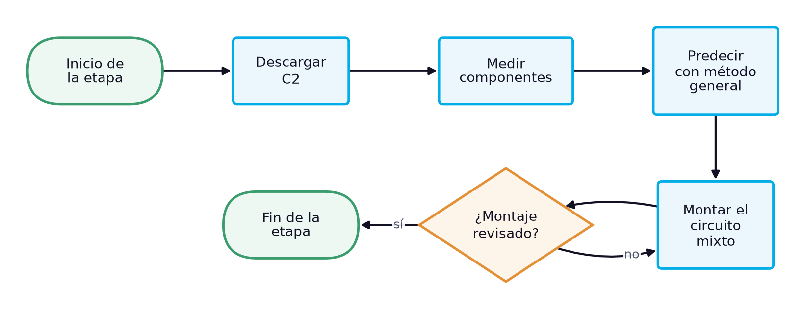
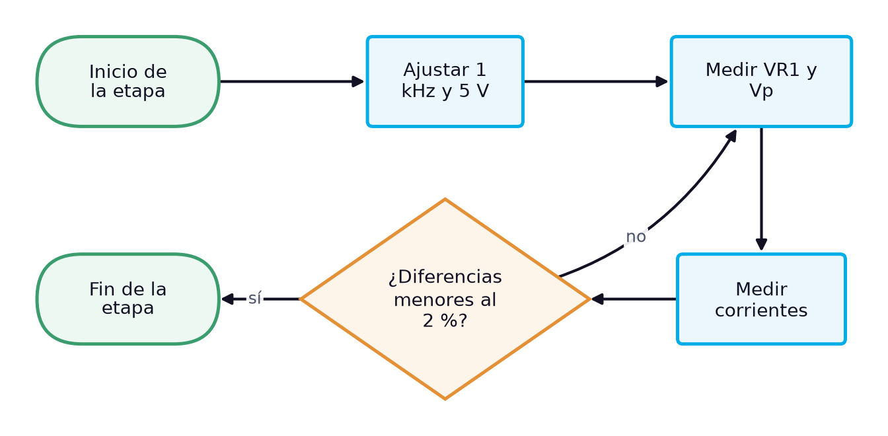
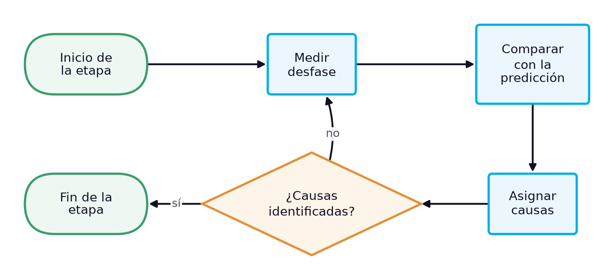

# Guía de laboratorio: Circuito RC mixto: predicción con el método general y medición de corrientes, tensiones y ángulo

> **Facultad:** Facultad de Ingenierías · **Módulo:** IEL04 — Circuitos Eléctricos I · **Docente:** Ing. Sergio Martinez Castilla
> **Semana:** 7 de 14 · **Resultado de aprendizaje:** [[IEL04-RA2]] · **Sesión:** [[IEL04-semana07]] · **Práctica:** propuesta a partir de la bibliografía [1] [2] [3] · **Duración:** 240 minutos

La práctica cierra el RA IEL04-RA2 y corresponde a la sesión teórica de la semana 7, «Cálculo y medición de parámetros en circuitos RC en serie, en paralelo y mixtos». Reproduce su caso de estudio: un resistor $R_1$ en serie con el paralelo de $R_2$ y C2, alimentado con 5,00 V eficaces a 1 kHz; primero se predicen con el método general de impedancias y admitancias la corriente, las tensiones y el ángulo, y después se miden y se explica cada diferencia. Sin un manual de laboratorio asignado, la práctica se propone a partir de la bibliografía cargada: Floyd trata el análisis de circuitos RC en serie-paralelo y el uso de las puntas ×1 y ×10 del osciloscopio y su efecto de carga [1], Boylestad las redes de ca en serie-paralelo [2] y Deorsola los instrumentos y mediciones [3].

## 1. Objetivos

**Objetivo general:** Comprobar experimentalmente la predicción del método general en un circuito RC mixto.

**Objetivos específicos:**

- Identificar y verificar con instrumentos los dos resistores y el condensador del circuito. *(CE1)*
- Medir las tensiones y las corrientes de rama del circuito con el multímetro de verdadero valor eficaz. *(CE2)*
- Medir la corriente total y su ángulo en el circuito RC mixto y compararlos con la predicción del método general. *(CE3)*

## 2. Materiales y Equipos

| # | Material o equipo | Especificación | Cantidad |
|---|---|---|---|
| 1 | Resistor R1 | 1 kΩ (medido 996 Ω en la sesión) | 1 |
| 2 | Resistor R2 | 1,5 kΩ ±5 % | 1 |
| 3 | Condensador C2 del kit | 104K, 97,8 nF medidos | 1 |
| 4 | Resistor sensor de corriente | 10 Ω | 1 |
| 5 | Generador de funciones | — | 1 |
| 6 | Osciloscopio de dos canales con puntas ×10 | — | 1 |
| 7 | Multímetro digital de verdadero valor eficaz | — | 2 |
| 8 | Medidor LCR | — | 1 |
| 9 | Protoboard | — | 1 |
| 10 | Cables de conexión | — | 12 |
| 11 | Resistencia de descarga | 1 kΩ | 1 |

## 3. Procedimiento

La práctica ocupa el bloque de 2 h de laboratorio de la sesión y se realiza en grupos de tres estudiantes, con tres roles que rotan entre etapas: quien monta y opera el circuito, quien mide y quien registra y verifica los cálculos. Antes de energizar cualquier montaje, el docente o el monitor revisa la conexión. Cada etapa abre con su diagrama de flujo, que muestra la secuencia y las comprobaciones de un vistazo, y sigue con sus pasos numerados; cada paso indica cuánto dura, qué debe observarse para saber que salió bien y qué hacer si no. Los valores numéricos de la sesión teórica sirven de referencia: las lecturas propias del grupo se registran en las tablas de la sección de análisis.

### 3.1 Preparación, predicción y montaje (31 min)

*Figura 1. Diagrama de flujo de la etapa 1: Preparación, predicción y montaje*

1. Descargar el condensador conectando entre sus terminales, durante unos segundos, una resistencia de 1 kΩ sujeta con pinzas aisladas, y medir con el voltímetro en cd la tensión entre terminales. *(≈ 3 min)* **Comprobación:** La tensión debe ser prácticamente nula (menos de 0,1 V); si no lo es, repetir la descarga antes de manipular el componente. **Seguridad:** No cortocircuitar los terminales con los dedos ni con una herramienta metálica: un condensador puede conservar carga después de desconectado.
2. Medir R1 y R2 con el ohmímetro y C2 con el medidor LCR, y anotar los valores. *(≈ 6 min)* **Comprobación:** R2 debe leer cerca de 1492 Ω y C2 cerca de 97,8 nF.
3. Calcular con los valores medidos la admitancia del paralelo, la impedancia total, la corriente, las tensiones $V_{R1}$ y $V_p$, las corrientes de rama y el ángulo. *(≈ 15 min)* **Comprobación:** La corriente total esperada es de unos 2,56 mA, adelantada unos 22° a la tensión; si el cálculo difiere mucho, revisar la conversión de admitancia a impedancia.
4. Montar R1 en serie con el paralelo de R2 y C2, con el resistor sensor en serie del lado de tierra. *(≈ 7 min)* **Comprobación:** El docente revisa el montaje antes de energizar. **Seguridad:** Montar con el generador apagado.

### 3.2 Medición de tensiones y corrientes (27 min)

*Figura 2. Diagrama de flujo de la etapa 2: Medición de tensiones y corrientes*

5. Ajustar el generador a una onda sinusoidal de 1 kHz y medir con el osciloscopio y con el multímetro de verdadero valor eficaz que la tensión en los bornes del circuito, con el circuito conectado, sea de 5,00 V eficaces. *(≈ 6 min)* **Comprobación:** El multímetro debe indicar 5,00 V y el osciloscopio una sinusoide sin distorsión; si la tensión baja al conectar el circuito, reajustar la amplitud con el circuito conectado.
6. Medir $V_{R1}$ y la tensión del paralelo $V_p$ con el multímetro de verdadero valor eficaz. *(≈ 6 min)* **Comprobación:** La suma aritmética debe superar 5 V; las lecturas deben estar a menos del 2 % de la predicción.
7. Con el circuito desenergizado, insertar el amperímetro en serie con la fuente, energizar y medir la corriente total; repetir en la rama de R2 y en la del condensador. *(≈ 15 min)* **Comprobación:** Las tres lecturas deben estar a menos del 2 % de la predicción; si una se aparta más, revisar el contacto del amperímetro. **Seguridad:** Insertar el amperímetro solo con el circuito desenergizado.

### 3.3 Ángulo y comparación (18 min)

*Figura 3. Diagrama de flujo de la etapa 3: Ángulo y comparación*

8. Medir con el osciloscopio el desfase entre la tensión de la fuente y la tensión en el resistor sensor, usando puntas ×10 [1]. *(≈ 8 min)* **Comprobación:** La corriente debe adelantar a la tensión unos 22°; si se ve atrasada, revisar la polaridad de las puntas.
9. Completar la tabla comparativa y anotar para cada diferencia su causa probable: resistencia del amperímetro, resolución del multímetro o de los cursores, o resistencia interna del generador [FUENTE NO CARGADA EN raw/]. *(≈ 10 min)* **Comprobación:** Cada diferencia mayor del 1 % debe tener una causa identificada; si no, repetir esa medición.

### 3.4 Desmontaje y cierre (10 min)

*Figura 4. Diagrama de flujo de la etapa 4: Desmontaje y cierre*

10. Apagar el generador de funciones y la fuente, desconectar las puntas del osciloscopio y retirar la alimentación del protoboard. *(≈ 3 min)* **Comprobación:** Ningún indicador de salida debe quedar encendido en el generador ni en la fuente. **Seguridad:** Desenergizar siempre antes de retirar componentes.
11. Descargar los condensadores del montaje con la resistencia de descarga, retirar los componentes y devolverlos al kit del grupo con su rótulo. *(≈ 4 min)* **Comprobación:** El kit debe quedar completo, con cada componente en su lugar y con su valor medido anotado.
12. Revisar con el docente las tablas de registro antes de abandonar el banco. *(≈ 3 min)* **Comprobación:** Las tablas deben estar completas y con unidades; si falta un dato, repetir esa medición antes de desmontar el instrumento.

## 4. Cuestiones a Resolver

1. ¿Por qué en la parte serie del circuito la suma aritmética de $V_{R1}$ y $V_p$ supera la tensión de la fuente?
2. ¿Cómo cambiaría la corriente total si se hubiera usado el valor nominal de C2 en lugar del medido?
3. ¿Qué efecto tiene la resistencia interna del amperímetro sobre la corriente de una rama de baja impedancia?
4. ¿Por qué se ajusta la tensión de la fuente en los bornes del circuito, con el circuito conectado, y no en el dial del generador?

## 5. Análisis de Resultados

Presentar en la tabla de registro la predicción con valores medidos, la medición y la diferencia porcentual de cada magnitud, y agregar la predicción con valores nominales para comparar cuál ajusta mejor.

Dibujar el diagrama fasorial del circuito: las corrientes de rama sumadas en el paralelo y las tensiones $V_{R1}$ y $V_p$ sumadas en la parte serie, y verificar ambas sumas con las lecturas.

**Tabla 1.** Circuito RC mixto a 1 kHz: predicción y medición

| Magnitud | Predicción | Medido | Unidad | Diferencia (%) | Causa probable |
|---|---|---|---|---|---|
|   |   |   |   |   |   |
|   |   |   |   |   |   |
|   |   |   |   |   |   |
|   |   |   |   |   |   |
|   |   |   |   |   |   |
|   |   |   |   |   |   |
|   |   |   |   |   |   |

## 6. Conclusiones

Concluir si el método general predice el comportamiento del circuito mixto dentro de la exactitud de los instrumentos, justificando cada diferencia con su causa física, y relacionar la práctica con los criterios de medición en circuitos resistivos, capacitivos y RC del RA.

- ¿Qué magnitud mostró la mayor diferencia y qué la causó?
- ¿Qué ventaja tuvo calcular con los valores medidos?
- ¿Qué efecto de los instrumentos fue relevante en esta práctica y cuál fue despreciable?

## 7. Recomendaciones de Seguridad

- Trabajar con el circuito desenergizado mientras se conecta o modifica el montaje; energizar solo después de la revisión del docente.
- Descargar los condensadores con una resistencia antes de manipularlos o medirlos, y respetar la polaridad de los electrolíticos: conectado con la polaridad invertida, un electrolítico puede explotar y provocar lesiones [1].
- Conectar las tierras de las dos puntas del osciloscopio a un mismo nodo de referencia: unirlas a nodos distintos cortocircuita el elemento que queda entre ellas.
- Insertar el amperímetro en serie con la rama solo con el circuito desenergizado y con el instrumento en la función y la escala de corriente; nunca conectarlo en paralelo con la fuente.

## 8. Bibliografía

[1] Floyd, Thomas L., *Principios de circuitos eléctricos*, 8.ª ed., Pearson Educación, 2007.

[2] Boylestad, Robert L., *Introducción al análisis de circuitos*, 10.ª ed., Pearson Educación, 2004.

[3] Deorsola, M. F. P., Morcelle del Valle, P., *Circuitos eléctricos. Parte 1*, 1.ª ed., Editorial de la Universidad de La Plata, 2017.

[4] *Manuales del generador de funciones, del multímetro digital y del osciloscopio del laboratorio*. [FUENTE NO CARGADA EN raw/]
