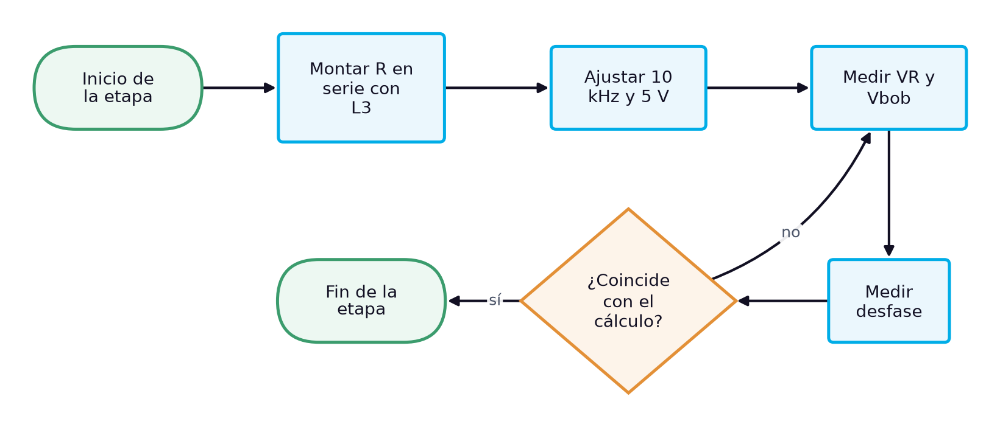
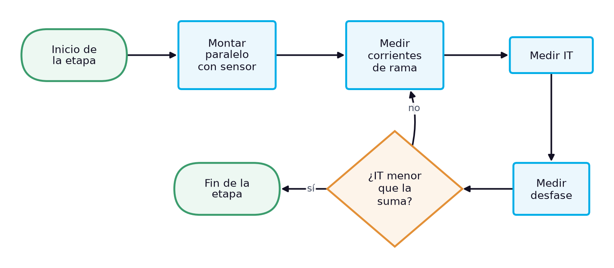

# Guía de laboratorio: Circuitos RL en serie y en paralelo con la bobina real: tensiones, corrientes y ángulos a 10 kHz

> **Facultad:** Facultad de Ingenierías · **Módulo:** IEL04 — Circuitos Eléctricos I · **Docente:** Ing. Sergio Martinez Castilla
> **Semana:** 8 de 14 · **Resultado de aprendizaje:** [[IEL04-RA3]] · **Sesión:** [[IEL04-semana08]] · **Práctica:** propuesta a partir de la bibliografía [1] [2] [3] · **Duración:** 240 minutos

La práctica corresponde a la sesión teórica de la semana 8, «Circuitos RL en serie y en paralelo: reactancia inductiva, impedancia y leyes de Kirchhoff con la bobina real», y reproduce su caso de estudio: con la bobina L3 del kit y un resistor de 680 Ω se miden, a 10 kHz y 5,00 V eficaces, las tensiones y el ángulo del circuito en serie y las corrientes y el ángulo del circuito en paralelo, y se comparan con el cálculo que incluye la resistencia de devanado y con el cálculo ideal. No hay un manual de laboratorio asignado al RA IEL04-RA3, por lo que la práctica se propone a partir de la bibliografía cargada: Floyd trata la reactancia inductiva y el análisis de circuitos RL en serie y en paralelo [1], Boylestad los circuitos de ca R-L [2] y Deorsola el circuito RL y las leyes de Kirchhoff con fasores [3].

## 1. Objetivos

**Objetivo general:** Verificar experimentalmente las leyes de Kirchhoff en circuitos RL en serie y en paralelo con una bobina real.

**Objetivos específicos:**

- Identificar y verificar con instrumentos la bobina y el resistor del circuito, incluida la resistencia de devanado. *(CE1)*
- Medir las tensiones en el resistor y en la bobina, y las corrientes de rama, con el multímetro de verdadero valor eficaz. *(CE2)*
- Medir el ángulo de fase de los circuitos RL en serie y en paralelo, y compararlo con el cálculo con resistencia de devanado y con el cálculo ideal. *(CE3)*

## 2. Materiales y Equipos

| # | Material o equipo | Especificación | Cantidad |
|---|---|---|---|
| 1 | Bobina L3 del kit | 103K, 10,4 mH y 24,6 Ω medidos | 1 |
| 2 | Resistor | 680 Ω | 1 |
| 3 | Resistor sensor de corriente | 10 Ω | 1 |
| 4 | Generador de funciones | — | 1 |
| 5 | Osciloscopio de dos canales con puntas ×10 | — | 1 |
| 6 | Multímetro digital de verdadero valor eficaz | — | 2 |
| 7 | Medidor LCR | — | 1 |
| 8 | Protoboard | — | 1 |
| 9 | Cables de conexión | — | 12 |

## 3. Procedimiento

La práctica ocupa el bloque de 2 h de laboratorio de la sesión y se realiza en grupos de tres estudiantes, con tres roles que rotan entre etapas: quien monta y opera el circuito, quien mide y quien registra y verifica los cálculos. Antes de energizar cualquier montaje, el docente o el monitor revisa la conexión. Cada etapa abre con su diagrama de flujo, que muestra la secuencia y las comprobaciones de un vistazo, y sigue con sus pasos numerados; cada paso indica cuánto dura, qué debe observarse para saber que salió bien y qué hacer si no. Los valores numéricos de la sesión teórica sirven de referencia: las lecturas propias del grupo se registran en las tablas de la sección de análisis.

### 3.1 Preparación y cálculo previo (18 min)

1. Verificar la bobina L3 con el medidor LCR (inductancia) y el ohmímetro (resistencia de devanado), y el resistor de 680 Ω con el ohmímetro. *(≈ 6 min)* **Comprobación:** L3 debe leer cerca de 10,4 mH y 24,6 Ω, y el resistor cerca de 676 Ω; si no, anotar los valores nuevos para los cálculos.
2. Calcular a 10 kHz la reactancia $X_L = 2\pi f L$, la impedancia del circuito en serie con y sin la resistencia de devanado, y las corrientes del circuito en paralelo. *(≈ 12 min)* **Comprobación:** Debe obtenerse $X_L$ cerca de 653 Ω y una corriente en serie cerca de 5,2 mA.

### 3.2 Circuito RL en serie (27 min)

*Figura 1. Diagrama de flujo de la etapa 2: Circuito RL en serie*

3. Montar el resistor en serie con L3, con la bobina del lado de tierra. *(≈ 5 min)* **Comprobación:** El docente revisa el montaje antes de energizar. **Seguridad:** Montar con el generador apagado.
4. Ajustar el generador a una onda sinusoidal de 10 kHz y medir con el osciloscopio y con el multímetro de verdadero valor eficaz que la tensión en los bornes del circuito, con el circuito conectado, sea de 5,00 V eficaces. *(≈ 6 min)* **Comprobación:** El multímetro debe indicar 5,00 V y el osciloscopio una sinusoide sin distorsión; si la tensión baja al conectar el circuito, reajustar la amplitud con el circuito conectado.
5. Medir con el multímetro de verdadero valor eficaz la tensión en el resistor y la tensión entre los terminales de la bobina. *(≈ 8 min)* **Comprobación:** Las lecturas deben estar cerca de 3,53 V y 3,41 V; su suma aritmética supera 5 V.
6. Medir con el osciloscopio el desfase entre la tensión de la fuente y la del resistor y calcular el ángulo. *(≈ 8 min)* **Comprobación:** La corriente debe atrasar a la tensión unos 43°; si el ángulo se acerca a 44°, comprobar si se omitió la resistencia de devanado en el cálculo.

### 3.3 Circuito RL en paralelo (28 min)

*Figura 2. Diagrama de flujo de la etapa 3: Circuito RL en paralelo*

7. Desenergizar y montar el resistor y L3 en paralelo, con el resistor sensor en serie con la fuente del lado de tierra. *(≈ 6 min)* **Comprobación:** El docente revisa el montaje. **Seguridad:** Desenergizar antes de modificar el montaje.
8. Con el circuito desenergizado, insertar el amperímetro en cada rama y en serie con la fuente, energizando para cada lectura, y anotar $I_R$, $I_{bob}$ e $I_T$. *(≈ 15 min)* **Comprobación:** Las lecturas deben estar cerca de 7,40 mA, 7,65 mA y 10,8 mA; $I_T$ debe ser menor que la suma aritmética.
9. Medir con el osciloscopio el desfase entre la tensión de la fuente y la del resistor sensor. *(≈ 7 min)* **Comprobación:** La corriente total debe atrasar a la tensión unos 45°.

### 3.4 Desmontaje y cierre (10 min)

*Figura 3. Diagrama de flujo de la etapa 4: Desmontaje y cierre*

10. Apagar el generador de funciones y la fuente, desconectar las puntas del osciloscopio y retirar la alimentación del protoboard. *(≈ 3 min)* **Comprobación:** Ningún indicador de salida debe quedar encendido en el generador ni en la fuente. **Seguridad:** Desenergizar siempre antes de retirar componentes.
11. Descargar los condensadores del montaje con la resistencia de descarga, retirar los componentes y devolverlos al kit del grupo con su rótulo. *(≈ 4 min)* **Comprobación:** El kit debe quedar completo, con cada componente en su lugar y con su valor medido anotado.
12. Revisar con el docente las tablas de registro antes de abandonar el banco. *(≈ 3 min)* **Comprobación:** Las tablas deben estar completas y con unidades; si falta un dato, repetir esa medición antes de desmontar el instrumento.

## 4. Cuestiones a Resolver

1. ¿En qué circuito, serie o paralelo, pesa más la resistencia de devanado de la bobina, y por qué?
2. ¿Cuánto se apartan las mediciones del cálculo ideal y cuánto del cálculo con resistencia de devanado?
3. ¿Por qué la tensión medida en la bobina no está adelantada exactamente 90° respecto de la corriente?
4. ¿Cómo cambiaría el efecto de la resistencia de devanado si la práctica se hiciera a 1 kHz en lugar de 10 kHz?

## 5. Análisis de Resultados

Presentar en la tabla de registro, para cada magnitud de los dos circuitos, el cálculo con resistencia de devanado, el cálculo ideal, la medición y la diferencia porcentual con el primero.

Dibujar el diagrama fasorial de tensiones del circuito en serie, con la tensión de la bobina real formada por su caída resistiva y su caída reactiva, y el de corrientes del circuito en paralelo; comprobar ambas sumas con las lecturas.

**Tabla 1.** Circuito RL en serie a 10 kHz

| Magnitud | Cálculo con RW | Cálculo ideal | Medido | Unidad | Diferencia (%) |
|---|---|---|---|---|---|
|   |   |   |   |   |   |
|   |   |   |   |   |   |
|   |   |   |   |   |   |
|   |   |   |   |   |   |

**Tabla 2.** Circuito RL en paralelo a 10 kHz

| Magnitud | Cálculo con RW | Cálculo ideal | Medido | Unidad | Diferencia (%) |
|---|---|---|---|---|---|
|   |   |   |   |   |   |
|   |   |   |   |   |   |
|   |   |   |   |   |   |
|   |   |   |   |   |   |

## 6. Conclusiones

Concluir si las leyes de Kirchhoff se cumplen en forma fasorial en los dos circuitos y cuál de los dos modelos de la bobina (real o ideal) reproduce mejor las mediciones, explicando el papel de la resistencia de devanado; relacionar la práctica con los criterios de medición en circuitos resistivos, inductivos y RL del RA.

- ¿Qué modelo de la bobina explicó mejor los ángulos medidos?
- ¿Qué diferencia hubo entre el comportamiento en serie y en paralelo?
- ¿Qué precaución del montaje fue determinante?

## 7. Recomendaciones de Seguridad

- Conectar las tierras de las dos puntas del osciloscopio a un mismo nodo de referencia: unirlas a nodos distintos cortocircuita el elemento que queda entre ellas.
- Insertar el amperímetro en serie con la rama solo con el circuito desenergizado y con el instrumento en la función y la escala de corriente; nunca conectarlo en paralelo con la fuente.
- Desenergizar antes de cambiar del montaje en serie al montaje en paralelo.
- No interrumpir bruscamente la corriente de la bobina con el circuito energizado.

## 8. Bibliografía

[1] Floyd, Thomas L., *Principios de circuitos eléctricos*, 8.ª ed., Pearson Educación, 2007.

[2] Boylestad, Robert L., *Introducción al análisis de circuitos*, 10.ª ed., Pearson Educación, 2004.

[3] Deorsola, M. F. P., Morcelle del Valle, P., *Circuitos eléctricos. Parte 1*, 1.ª ed., Editorial de la Universidad de La Plata, 2017.
