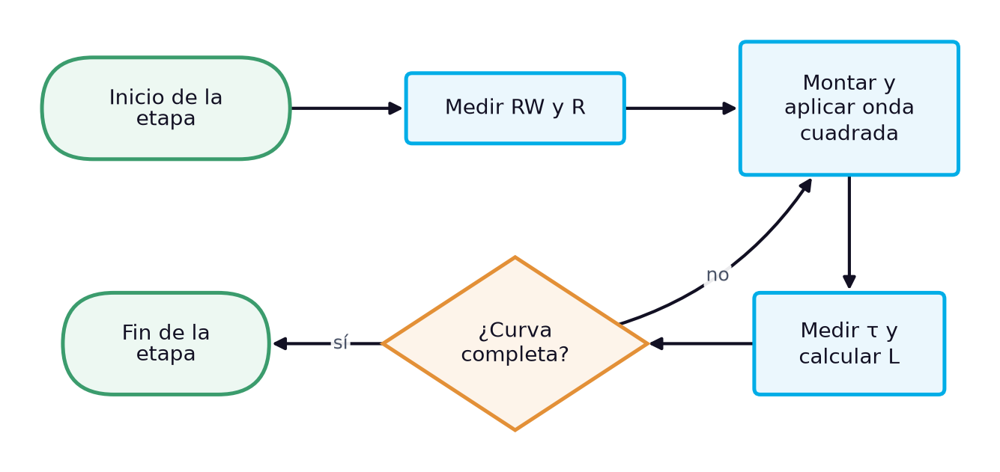
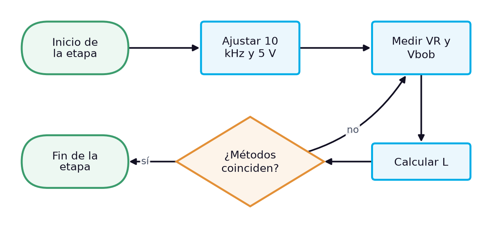
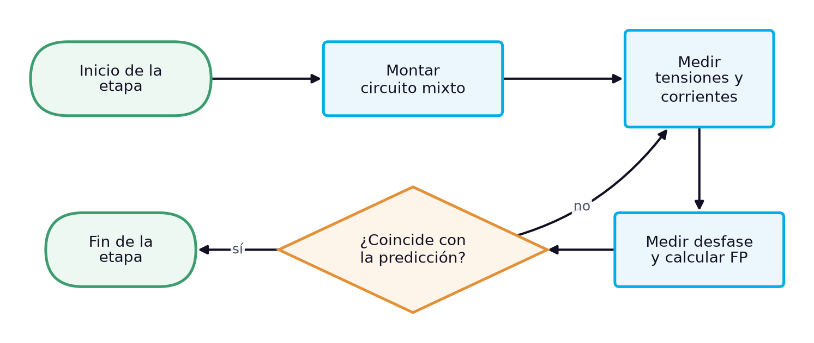

# Guía de laboratorio: Identificación de una bobina por su constante de tiempo y su impedancia, y medición de un circuito RL mixto

> **Facultad:** Facultad de Ingenierías · **Módulo:** IEL04 — Circuitos Eléctricos I · **Docente:** Ing. Sergio Martinez Castilla
> **Semana:** 9 de 14 · **Resultado de aprendizaje:** [[IEL04-RA3]] · **Sesión:** [[IEL04-semana09]] · **Práctica:** propuesta a partir de la bibliografía [1] [2] [3] · **Duración:** 240 minutos

La práctica cierra el RA IEL04-RA3 y corresponde a la sesión teórica de la semana 9, «Cálculo y medición de parámetros en circuitos RL según el conexionado». Reproduce su caso de estudio: determinar la inductancia de una bobina sin marcado por dos métodos independientes —su constante de tiempo con una onda cuadrada y su impedancia con una señal sinusoidal—, identificar a qué valor estándar corresponde y usarla en un circuito RL mixto, del que se miden la corriente, las tensiones y el factor de potencia. No hay un manual de laboratorio asignado, por lo que la práctica se propone a partir de la bibliografía cargada: Floyd trata la constante de tiempo L/R, la potencia en circuitos RL y los circuitos RL en serie-paralelo [1], Boylestad los transitorios R-L y los valores estándar de inductores [2] y Deorsola el régimen transitorio del circuito RL [3].

## 1. Objetivos

**Objetivo general:** Determinar experimentalmente la inductancia de una bobina por dos métodos y verificar el cálculo de un circuito RL mixto.

**Objetivos específicos:**

- Identificar el valor estándar de una bobina sin marcado a partir de sus mediciones. *(CE1)*
- Medir la constante de tiempo y la impedancia de la bobina en un circuito resistivo e inductivo. *(CE2)*
- Medir corrientes, tensiones, ángulo y factor de potencia en un circuito RL mixto y compararlos con el cálculo. *(CE3)*

## 2. Materiales y Equipos

| # | Material o equipo | Especificación | Cantidad |
|---|---|---|---|
| 1 | Bobina toroidal sin marcado | — | 1 |
| 2 | Resistor | 1 kΩ (medido 996 Ω en la sesión) | 1 |
| 3 | Resistor R1 | 470 Ω | 1 |
| 4 | Resistor R2 | 680 Ω | 1 |
| 5 | Resistor sensor de corriente | 10 Ω | 1 |
| 6 | Generador de funciones | — | 1 |
| 7 | Osciloscopio de dos canales con puntas ×10 | — | 1 |
| 8 | Multímetro digital de verdadero valor eficaz | — | 2 |
| 9 | Medidor LCR | — | 1 |
| 10 | Protoboard | — | 1 |
| 11 | Cables de conexión | — | 12 |

## 3. Procedimiento

La práctica ocupa el bloque de 2 h de laboratorio de la sesión y se realiza en grupos de tres estudiantes, con tres roles que rotan entre etapas: quien monta y opera el circuito, quien mide y quien registra y verifica los cálculos. Antes de energizar cualquier montaje, el docente o el monitor revisa la conexión. Cada etapa abre con su diagrama de flujo, que muestra la secuencia y las comprobaciones de un vistazo, y sigue con sus pasos numerados; cada paso indica cuánto dura, qué debe observarse para saber que salió bien y qué hacer si no. Los valores numéricos de la sesión teórica sirven de referencia: las lecturas propias del grupo se registran en las tablas de la sección de análisis.

### 3.1 Método 1: constante de tiempo (21 min)

*Figura 1. Diagrama de flujo de la etapa 1: Método 1: constante de tiempo*

1. Medir con el ohmímetro la resistencia de devanado de la bobina y la del resistor de 1 kΩ. *(≈ 5 min)* **Comprobación:** La resistencia de devanado debe ser de pocos ohmios; una lectura infinita indica devanado abierto.
2. Montar la bobina en serie con el resistor de 1 kΩ y aplicar una onda cuadrada de 0 V a 5 V y 10 kHz. *(≈ 6 min)* **Comprobación:** El docente revisa el montaje antes de energizar. **Seguridad:** Montar con el generador apagado.
3. Con la punta del canal 2 sobre el resistor, medir con los cursores el tiempo en que la tensión alcanza el 63 % de su valor final y calcular $L = \tau (R + R_W)$ [1]. *(≈ 10 min)* **Comprobación:** El semiperiodo de 50 µs debe superar con holgura cinco constantes de tiempo; si la curva no llega a la meseta, reducir la frecuencia.

### 3.2 Método 2: impedancia (26 min)

*Figura 2. Diagrama de flujo de la etapa 2: Método 2: impedancia*

4. Ajustar el generador a una onda sinusoidal de 10 kHz y medir con el osciloscopio y con el multímetro de verdadero valor eficaz que la tensión en los bornes del circuito, con el circuito conectado, sea de 5,00 V eficaces. *(≈ 6 min)* **Comprobación:** El multímetro debe indicar 5,00 V y el osciloscopio una sinusoide sin distorsión; si la tensión baja al conectar el circuito, reajustar la amplitud con el circuito conectado.
5. Medir la tensión en el resistor para obtener la corriente y la tensión en la bobina con la resta de canales del osciloscopio. *(≈ 10 min)* **Comprobación:** Debe obtenerse una corriente cercana a 4,86 mA; si la resta de canales da ruido, verificar que ambos canales tengan la misma escala.
6. Calcular $Z_{bob} = V_{bob}/I$, $X_L = \sqrt{Z_{bob}^2 - R_W^2}$ y $L = X_L/(2\pi f)$, y compararla con la del método 1; identificar el valor estándar más cercano [2]. *(≈ 10 min)* **Comprobación:** Los dos métodos deben coincidir a pocos por ciento; si no, repetir la medición de τ.

### 3.3 Circuito RL mixto (35 min)

*Figura 3. Diagrama de flujo de la etapa 3: Circuito RL mixto*

7. Montar R1 en serie con el paralelo de R2 y la bobina identificada, con el resistor sensor en serie del lado de tierra, y predecir la corriente, las tensiones y el ángulo con los valores medidos. *(≈ 12 min)* **Comprobación:** La corriente esperada es de unos 8,8 mA con un factor de potencia cercano a 0,95. **Seguridad:** Montar con el generador apagado.
8. Medir la corriente total, $V_{R1}$, la tensión del paralelo y las corrientes de rama con el multímetro de verdadero valor eficaz. *(≈ 15 min)* **Comprobación:** Las lecturas deben estar a menos del 2 % de la predicción. **Seguridad:** Insertar el amperímetro solo con el circuito desenergizado.
9. Medir el desfase de la corriente total con el osciloscopio y calcular el factor de potencia $FP = \cos\theta$ y la potencia real $P = V I \cos\theta$ [1]. *(≈ 8 min)* **Comprobación:** El ángulo debe estar cerca de 19° de atraso.

### 3.4 Desmontaje y cierre (10 min)

*Figura 4. Diagrama de flujo de la etapa 4: Desmontaje y cierre*

10. Apagar el generador de funciones y la fuente, desconectar las puntas del osciloscopio y retirar la alimentación del protoboard. *(≈ 3 min)* **Comprobación:** Ningún indicador de salida debe quedar encendido en el generador ni en la fuente. **Seguridad:** Desenergizar siempre antes de retirar componentes.
11. Descargar los condensadores del montaje con la resistencia de descarga, retirar los componentes y devolverlos al kit del grupo con su rótulo. *(≈ 4 min)* **Comprobación:** El kit debe quedar completo, con cada componente en su lugar y con su valor medido anotado.
12. Revisar con el docente las tablas de registro antes de abandonar el banco. *(≈ 3 min)* **Comprobación:** Las tablas deben estar completas y con unidades; si falta un dato, repetir esa medición antes de desmontar el instrumento.

## 4. Cuestiones a Resolver

1. ¿Por qué dos métodos independientes, uno en el dominio del tiempo y otro en el de la frecuencia, dan confianza en el valor de la inductancia?
2. ¿Qué error se cometería al calcular L con la constante de tiempo usando solo la resistencia del resistor y no la de devanado?
3. ¿A qué valor estándar corresponde la bobina y con qué criterio se eligió?
4. ¿Qué significa el factor de potencia medido del circuito mixto y cómo podría corregirse?

## 5. Análisis de Resultados

Calcular la inductancia por los dos métodos, con su diferencia porcentual, e identificar el valor estándar más cercano de la serie de inductores.

Presentar en la tabla del circuito mixto la predicción, la medición y la diferencia de cada magnitud, y calcular el factor de potencia y las potencias real, reactiva y aparente con las lecturas.

**Tabla 1.** Inductancia de la bobina sin marcado

| Método | Magnitud medida | Valor medido | L calculada (mH) | Diferencia entre métodos (%) |
|---|---|---|---|---|
|   |   |   |   |   |
|   |   |   |   |   |

**Tabla 2.** Circuito RL mixto a 10 kHz

| Magnitud | Calculado | Medido | Unidad | Diferencia (%) |
|---|---|---|---|---|
|   |   |   |   |   |
|   |   |   |   |   |
|   |   |   |   |   |
|   |   |   |   |   |
|   |   |   |   |   |
|   |   |   |   |   |
|   |   |   |   |   |

## 6. Conclusiones

Concluir qué inductancia tiene la bobina y a qué valor estándar corresponde, apoyándose en la concordancia de los dos métodos, y si el circuito mixto se comporta como predice el cálculo; relacionar la práctica con los criterios de medición en circuitos resistivos, inductivos y RL del RA.

- ¿Qué método resultó más preciso y por qué?
- ¿Qué aprendieron sobre la medición de inductancia sin un medidor LCR?
- ¿Hubo algún resultado inesperado en el circuito mixto?

## 7. Recomendaciones de Seguridad

- Conectar las tierras de las dos puntas del osciloscopio a un mismo nodo de referencia: unirlas a nodos distintos cortocircuita el elemento que queda entre ellas.
- Insertar el amperímetro en serie con la rama solo con el circuito desenergizado y con el instrumento en la función y la escala de corriente; nunca conectarlo en paralelo con la fuente.
- No interrumpir bruscamente la corriente de la bobina con el circuito energizado.
- Desenergizar antes de pasar del montaje de los métodos 1 y 2 al circuito mixto.

## 8. Bibliografía

[1] Floyd, Thomas L., *Principios de circuitos eléctricos*, 8.ª ed., Pearson Educación, 2007.

[2] Boylestad, Robert L., *Introducción al análisis de circuitos*, 10.ª ed., Pearson Educación, 2004.

[3] Deorsola, M. F. P., Morcelle del Valle, P., *Circuitos eléctricos. Parte 1*, 1.ª ed., Editorial de la Universidad de La Plata, 2017.
