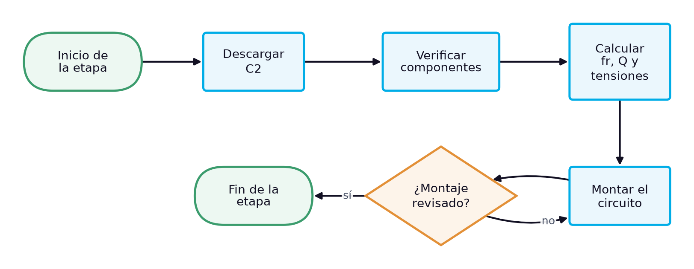
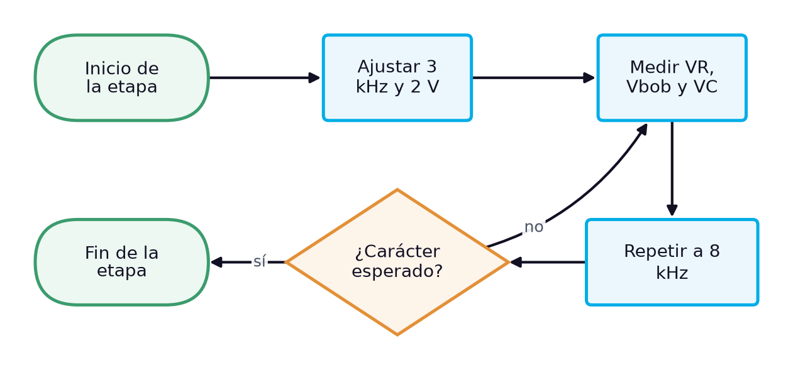
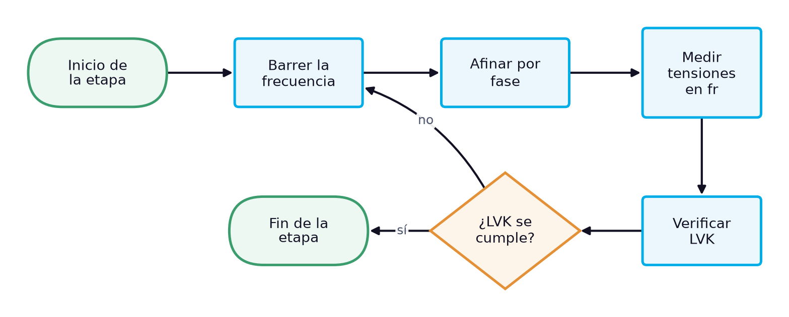

# Guía de laboratorio: Circuito RLC en serie: tensiones antes, en y después de la resonancia y ley de voltajes de Kirchhoff

> **Facultad:** Facultad de Ingenierías · **Módulo:** IEL04 — Circuitos Eléctricos I · **Docente:** Ing. Sergio Martinez Castilla
> **Semana:** 11 de 14 · **Resultado de aprendizaje:** [[IEL04-RA4]] · **Sesión:** [[IEL04-semana11]] · **Práctica:** propuesta a partir de la bibliografía [1] [2] [3] · **Duración:** 240 minutos

La práctica corresponde a la sesión teórica de la semana 11, «El circuito RLC en serie: reactancias opuestas, ley de voltajes de Kirchhoff y resonancia en serie», y reproduce su caso de estudio: con el resistor de 100 Ω, la bobina L3 y el condensador C2 del kit en serie, alimentados con 2,00 V eficaces, se miden la corriente y las tensiones a 3 kHz, en la resonancia y a 8 kHz, y se verifica la ley de voltajes de Kirchhoff con la bobina real. No hay un manual de laboratorio asignado al RA IEL04-RA4, por lo que la práctica se propone a partir de la bibliografía cargada: Floyd trata la impedancia, el análisis y la resonancia de los circuitos RLC en serie [1], Boylestad el circuito resonante en serie y el factor de calidad [2] y Deorsola las leyes de Kirchhoff con fasores [3].

## 1. Objetivos

**Objetivo general:** Verificar experimentalmente el comportamiento de un circuito RLC en serie antes, en y después de su frecuencia de resonancia.

**Objetivos específicos:**

- Identificar y verificar con instrumentos el resistor, la bobina y el condensador del circuito. *(CE1)*
- Medir la corriente y las tensiones del resistor, la bobina y el condensador a tres frecuencias. *(CE2)*
- Localizar experimentalmente la frecuencia de resonancia del circuito RLC en serie y verificar en ella la ley de voltajes de Kirchhoff con la bobina real. *(CE3)*

## 2. Materiales y Equipos

| # | Material o equipo | Especificación | Cantidad |
|---|---|---|---|
| 1 | Resistor | 100 Ω (medido 99,5 Ω en la sesión) | 1 |
| 2 | Bobina L3 del kit | 103K, 10,4 mH y 24,6 Ω medidos | 1 |
| 3 | Condensador C2 del kit | 104K, 97,8 nF medidos | 1 |
| 4 | Generador de funciones | — | 1 |
| 5 | Osciloscopio de dos canales con puntas ×10 | — | 1 |
| 6 | Multímetro digital de verdadero valor eficaz | — | 2 |
| 7 | Medidor LCR | — | 1 |
| 8 | Protoboard | — | 1 |
| 9 | Cables de conexión | — | 12 |
| 10 | Resistencia de descarga | 1 kΩ | 1 |

## 3. Procedimiento

La práctica ocupa el bloque de 2 h de laboratorio de la sesión y se realiza en grupos de tres estudiantes, con tres roles que rotan entre etapas: quien monta y opera el circuito, quien mide y quien registra y verifica los cálculos. Antes de energizar cualquier montaje, el docente o el monitor revisa la conexión. Cada etapa abre con su diagrama de flujo, que muestra la secuencia y las comprobaciones de un vistazo, y sigue con sus pasos numerados; cada paso indica cuánto dura, qué debe observarse para saber que salió bien y qué hacer si no. Los valores numéricos de la sesión teórica sirven de referencia: las lecturas propias del grupo se registran en las tablas de la sección de análisis.

### 3.1 Preparación y predicción (32 min)

*Figura 1. Diagrama de flujo de la etapa 1: Preparación y predicción*

1. Descargar el condensador conectando entre sus terminales, durante unos segundos, una resistencia de 1 kΩ sujeta con pinzas aisladas, y medir con el voltímetro en cd la tensión entre terminales. *(≈ 3 min)* **Comprobación:** La tensión debe ser prácticamente nula (menos de 0,1 V); si no lo es, repetir la descarga antes de manipular el componente. **Seguridad:** No cortocircuitar los terminales con los dedos ni con una herramienta metálica: un condensador puede conservar carga después de desconectado.
2. Verificar el resistor con el ohmímetro, la bobina L3 con el medidor LCR y el ohmímetro (10,4 mH y 24,6 Ω esperados) y el condensador C2 con el medidor LCR (97,8 nF esperados). *(≈ 8 min)* **Comprobación:** Si algún valor difiere más que su tolerancia del registrado, anotar el nuevo valor y rehacer el cálculo previo con él.
3. Calcular con los valores medidos la frecuencia de resonancia $f_r = 1/(2\pi\sqrt{LC})$, el factor de calidad $Q = X_L/(R + R_W)$ y la corriente y las tensiones esperadas a 3 kHz, en $f_r$ y a 8 kHz. *(≈ 15 min)* **Comprobación:** Debe obtenerse $f_r$ cerca de 4,99 kHz y una corriente en la resonancia cerca de 16 mA.
4. Montar en serie el resistor, L3 y C2, con el condensador del lado de tierra. *(≈ 6 min)* **Comprobación:** El docente revisa el montaje antes de energizar. **Seguridad:** Montar con el generador apagado.

### 3.2 Medición a 3 kHz y 8 kHz (26 min)

*Figura 2. Diagrama de flujo de la etapa 2: Medición a 3 kHz y 8 kHz*

5. Ajustar el generador a una onda sinusoidal de 3 kHz y medir con el osciloscopio y con el multímetro de verdadero valor eficaz que la tensión en los bornes del circuito, con el circuito conectado, sea de 2,00 V eficaces. *(≈ 6 min)* **Comprobación:** El multímetro debe indicar 2,00 V y el osciloscopio una sinusoide sin distorsión; si la tensión baja al conectar el circuito, reajustar la amplitud con el circuito conectado.
6. Medir con el multímetro de verdadero valor eficaz las tensiones en el resistor, en la bobina y en el condensador, y calcular la corriente como $V_R/R$. *(≈ 10 min)* **Comprobación:** A 3 kHz la tensión del condensador debe superar a la de la bobina (carácter capacitivo).
7. Repetir a 8 kHz, reajustando la tensión de la fuente a 2,00 V eficaces. *(≈ 10 min)* **Comprobación:** A 8 kHz la tensión de la bobina debe superar a la del condensador (carácter inductivo).

### 3.3 Resonancia y ley de voltajes de Kirchhoff (28 min)

*Figura 3. Diagrama de flujo de la etapa 3: Resonancia y ley de voltajes de Kirchhoff*

8. Barrer la frecuencia entre 3 kHz y 8 kHz buscando el máximo de la tensión en el resistor, reajustando la fuente a 2,00 V eficaces. *(≈ 10 min)* **Comprobación:** El máximo debe aparecer cerca de 5 kHz; si no se encuentra, revisar las conexiones de la serie.
9. Afinar la resonancia con el osciloscopio, buscando que la tensión del resistor quede en fase con la de la fuente, y anotar la frecuencia. *(≈ 8 min)* **Comprobación:** La diferencia con $f_r$ calculada debe ser de pocos por ciento.
10. Medir en la resonancia las tensiones en el resistor, la bobina y el condensador, y comprobar que $V_S \approx V_R + I R_W$. *(≈ 10 min)* **Comprobación:** La tensión del resistor debe ser cercana a 1,60 V y la suma con la caída en la resistencia de devanado, cercana a 2,00 V.

### 3.4 Desmontaje y cierre (10 min)

*Figura 4. Diagrama de flujo de la etapa 4: Desmontaje y cierre*

11. Apagar el generador de funciones y la fuente, desconectar las puntas del osciloscopio y retirar la alimentación del protoboard. *(≈ 3 min)* **Comprobación:** Ningún indicador de salida debe quedar encendido en el generador ni en la fuente. **Seguridad:** Desenergizar siempre antes de retirar componentes.
12. Descargar los condensadores del montaje con la resistencia de descarga, retirar los componentes y devolverlos al kit del grupo con su rótulo. *(≈ 4 min)* **Comprobación:** El kit debe quedar completo, con cada componente en su lugar y con su valor medido anotado.
13. Revisar con el docente las tablas de registro antes de abandonar el banco. *(≈ 3 min)* **Comprobación:** Las tablas deben estar completas y con unidades; si falta un dato, repetir esa medición antes de desmontar el instrumento.

## 4. Cuestiones a Resolver

1. ¿Por qué en la resonancia la tensión en el condensador puede ser mayor que la de la fuente?
2. ¿Qué papel tiene la resistencia de devanado de la bobina en la ley de voltajes de Kirchhoff en la resonancia?
3. ¿Cómo cambia el carácter del circuito (capacitivo, resistivo o inductivo) al pasar por la resonancia, y cómo se observó?
4. ¿Qué diferencia hay entre la resonancia medida y la del circuito tanque de la semana 3 con los mismos componentes, y a qué se debe?

## 5. Análisis de Resultados

Presentar en la tabla de registro la corriente y las tensiones calculadas y medidas a las tres frecuencias, con su diferencia porcentual, y señalar el carácter del circuito en cada una.

Dibujar el diagrama fasorial de tensiones en la resonancia y a 3 kHz, con la tensión de la bobina real descompuesta en su caída resistiva y su caída reactiva, y comprobar que la suma fasorial reproduce la tensión de la fuente mientras la aritmética no lo hace.

**Tabla 1.** RLC en serie con VS = 2,00 V eficaces

| Frecuencia (kHz) | I (mA) | VR (V) | Vbob (V) | VC (V) | Carácter |
|---|---|---|---|---|---|
|   |   |   |   |   |   |
|   |   |   |   |   |   |
|   |   |   |   |   |   |
|   |   |   |   |   |   |

## 6. Conclusiones

Concluir si las mediciones reproducen el comportamiento del circuito RLC en serie a ambos lados de la resonancia y en ella, explicando la influencia de la resistencia de devanado y de las capacitancias parásitas; relacionar la práctica con los criterios de medición en circuitos RLC del RA.

- ¿Qué tan cerca estuvo la resonancia medida de la calculada?
- ¿Qué demostró la verificación de la ley de voltajes de Kirchhoff en la resonancia?
- ¿Qué resultado fue inesperado y cómo se explica?

## 7. Recomendaciones de Seguridad

- Trabajar con el circuito desenergizado mientras se conecta o modifica el montaje; energizar solo después de la revisión del docente.
- Mantener la tensión de la fuente en 2,00 V eficaces: en la resonancia en serie la tensión en la bobina y en el condensador supera varias veces la de la fuente [1].
- Conectar las tierras de las dos puntas del osciloscopio a un mismo nodo de referencia: unirlas a nodos distintos cortocircuita el elemento que queda entre ellas.

## 8. Bibliografía

[1] Floyd, Thomas L., *Principios de circuitos eléctricos*, 8.ª ed., Pearson Educación, 2007.

[2] Boylestad, Robert L., *Introducción al análisis de circuitos*, 10.ª ed., Pearson Educación, 2004.

[3] Deorsola, M. F. P., Morcelle del Valle, P., *Circuitos eléctricos. Parte 1*, 1.ª ed., Editorial de la Universidad de La Plata, 2017.
