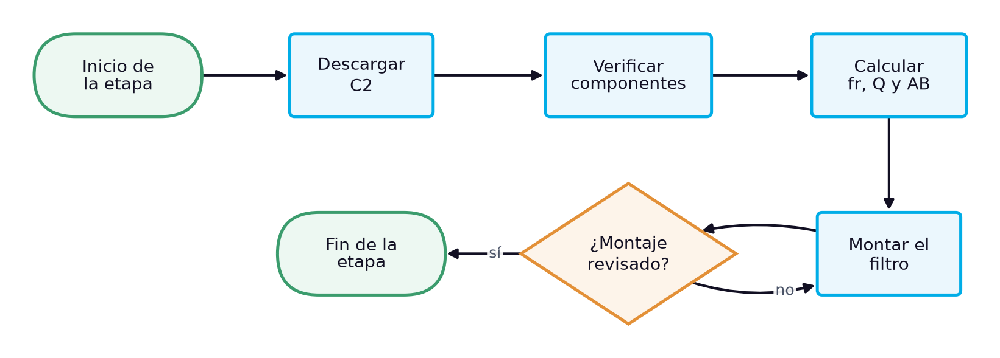
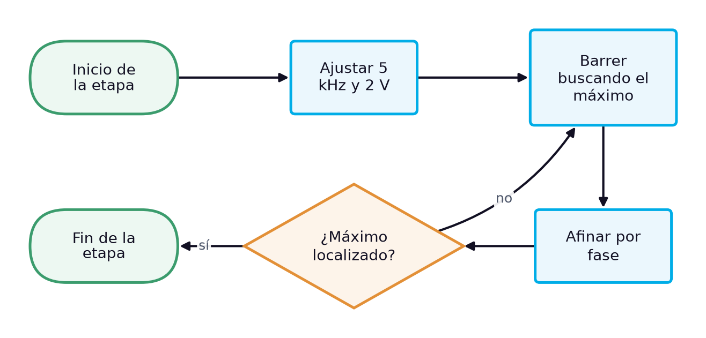
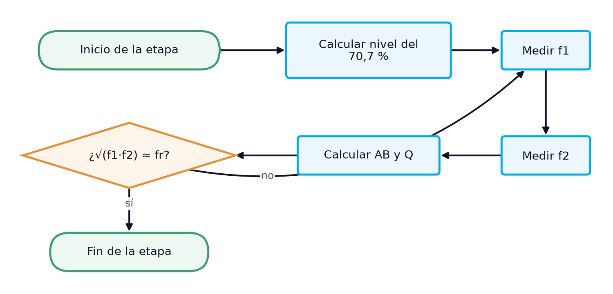

# Guía de laboratorio: Caracterización de un filtro pasabanda RLC en serie: frecuencia de resonancia, frecuencias de corte, ancho de banda y factor de calidad

> **Facultad:** Facultad de Ingenierías · **Módulo:** IEL04 — Circuitos Eléctricos I · **Docente:** Ing. Sergio Martinez Castilla
> **Semana:** 13 de 14 · **Resultado de aprendizaje:** [[IEL04-RA4]] · **Sesión:** [[IEL04-semana13]] · **Práctica:** propuesta a partir de la bibliografía [1] [2] [3] · **Duración:** 240 minutos

La práctica cierra el RA IEL04-RA4 y corresponde a la sesión teórica de la semana 13, «Cálculo y medición de parámetros en circuitos RLC en serie, en paralelo y mixtos: filtros resonantes, frecuencia de resonancia, ancho de banda y nomenclatura». Reproduce su caso de estudio: un filtro pasabanda formado por el resistor de 100 Ω, la bobina L3 y el condensador C2 en serie, con la salida en el resistor, del que se miden la frecuencia de resonancia, las frecuencias de corte, el ancho de banda y el factor de calidad. No hay un manual de laboratorio asignado, por lo que la práctica se propone a partir de la bibliografía cargada: Floyd define el ancho de banda de los circuitos resonantes entre las frecuencias en que la respuesta cae al 70,7 % y trata los filtros pasabanda [1], Boylestad el factor de calidad y la selectividad [2] y Deorsola la nomenclatura y la simbología de los circuitos [3].

## 1. Objetivos

**Objetivo general:** Caracterizar experimentalmente un filtro pasabanda RLC en serie y contrastar sus parámetros con el cálculo.

**Objetivos específicos:**

- Identificar y verificar con instrumentos los componentes del filtro, con su simbología y sus unidades. *(CE1)*
- Medir la tensión de salida del filtro en función de la frecuencia con el multímetro y el osciloscopio. *(CE2)*
- Determinar experimentalmente la frecuencia de resonancia, las frecuencias de corte, el ancho de banda y el factor de calidad del circuito RLC en serie. *(CE3)*

## 2. Materiales y Equipos

| # | Material o equipo | Especificación | Cantidad |
|---|---|---|---|
| 1 | Resistor | 100 Ω (medido 99,5 Ω en la sesión) | 1 |
| 2 | Bobina L3 del kit | 103K, 10,4 mH y 24,6 Ω medidos | 1 |
| 3 | Condensador C2 del kit | 104K, 97,8 nF medidos | 1 |
| 4 | Generador de funciones | — | 1 |
| 5 | Osciloscopio de dos canales con puntas ×10 | — | 1 |
| 6 | Multímetro digital de verdadero valor eficaz | — | 2 |
| 7 | Medidor LCR | — | 1 |
| 8 | Protoboard | — | 1 |
| 9 | Cables de conexión | — | 12 |
| 10 | Resistencia de descarga | 1 kΩ | 1 |

## 3. Procedimiento

La práctica ocupa el bloque de 2 h de laboratorio de la sesión y se realiza en grupos de tres estudiantes, con tres roles que rotan entre etapas: quien monta y opera el circuito, quien mide y quien registra y verifica los cálculos. Antes de energizar cualquier montaje, el docente o el monitor revisa la conexión. Cada etapa abre con su diagrama de flujo, que muestra la secuencia y las comprobaciones de un vistazo, y sigue con sus pasos numerados; cada paso indica cuánto dura, qué debe observarse para saber que salió bien y qué hacer si no. Los valores numéricos de la sesión teórica sirven de referencia: las lecturas propias del grupo se registran en las tablas de la sección de análisis.

### 3.1 Preparación y predicción (29 min)

*Figura 1. Diagrama de flujo de la etapa 1: Preparación y predicción*

1. Descargar el condensador conectando entre sus terminales, durante unos segundos, una resistencia de 1 kΩ sujeta con pinzas aisladas, y medir con el voltímetro en cd la tensión entre terminales. *(≈ 3 min)* **Comprobación:** La tensión debe ser prácticamente nula (menos de 0,1 V); si no lo es, repetir la descarga antes de manipular el componente. **Seguridad:** No cortocircuitar los terminales con los dedos ni con una herramienta metálica: un condensador puede conservar carga después de desconectado.
2. Verificar el resistor con el ohmímetro, la bobina L3 con el medidor LCR y el ohmímetro (10,4 mH y 24,6 Ω esperados) y el condensador C2 con el medidor LCR (97,8 nF esperados). *(≈ 8 min)* **Comprobación:** Si algún valor difiere más que su tolerancia del registrado, anotar el nuevo valor y rehacer el cálculo previo con él.
3. Calcular con los valores medidos la frecuencia de resonancia, el factor de calidad con la resistencia total del lazo $R + R_W$, las frecuencias de corte y el ancho de banda $AB = f_r/Q$. *(≈ 12 min)* **Comprobación:** Deben obtenerse $f_r$ cerca de 4990 Hz, Q cerca de 2,6 y un ancho de banda cercano a 1900 Hz.
4. Montar en serie el resistor, L3 y C2, con el resistor del lado de tierra para medir en él la salida. *(≈ 6 min)* **Comprobación:** El docente revisa el montaje antes de energizar. **Seguridad:** Montar con el generador apagado.

### 3.2 Resonancia del filtro (22 min)

*Figura 2. Diagrama de flujo de la etapa 2: Resonancia del filtro*

5. Ajustar el generador a una onda sinusoidal de 5 kHz y medir con el osciloscopio y con el multímetro de verdadero valor eficaz que la tensión en los bornes del circuito, con el circuito conectado, sea de 2,00 V eficaces. *(≈ 6 min)* **Comprobación:** El multímetro debe indicar 2,00 V y el osciloscopio una sinusoide sin distorsión; si la tensión baja al conectar el circuito, reajustar la amplitud con el circuito conectado.
6. Barrer la frecuencia buscando el máximo de la tensión en el resistor, reajustando la entrada a 2,00 V eficaces a cada frecuencia. *(≈ 8 min)* **Comprobación:** El máximo debe estar cerca de 5 kHz y por debajo de 2,00 V por la resistencia de devanado.
7. Afinar la resonancia por fase con el osciloscopio (tensión del resistor en fase con la de la fuente) y anotar $f_r$ y la tensión de salida máxima. *(≈ 8 min)* **Comprobación:** La tensión de salida máxima esperada es cercana a 1,60 V.

### 3.3 Frecuencias de corte y ancho de banda (28 min)

*Figura 3. Diagrama de flujo de la etapa 3: Frecuencias de corte y ancho de banda*

8. Calcular el 70,7 % de la tensión de salida máxima [1]. *(≈ 2 min)* **Comprobación:** Con 1,60 V de máximo, el nivel de corte es de unos 1,13 V.
9. Bajar la frecuencia desde $f_r$ hasta que la salida caiga a ese nivel, reajustando la entrada, y anotar $f_1$. *(≈ 10 min)* **Comprobación:** $f_1$ debe estar cerca de 4,1 kHz.
10. Subir la frecuencia desde $f_r$ hasta el mismo nivel y anotar $f_2$. *(≈ 10 min)* **Comprobación:** $f_2$ debe estar cerca de 6,0 kHz.
11. Calcular $AB = f_2 - f_1$, $Q = f_r/AB$ y la comprobación $\sqrt{f_1 f_2}$, que debe coincidir con $f_r$. *(≈ 6 min)* **Comprobación:** Si $\sqrt{f_1 f_2}$ se aparta más del 2 % de $f_r$, repetir la medición de la frecuencia de corte más dudosa.

### 3.4 Desmontaje y cierre (10 min)

*Figura 4. Diagrama de flujo de la etapa 4: Desmontaje y cierre*

12. Apagar el generador de funciones y la fuente, desconectar las puntas del osciloscopio y retirar la alimentación del protoboard. *(≈ 3 min)* **Comprobación:** Ningún indicador de salida debe quedar encendido en el generador ni en la fuente. **Seguridad:** Desenergizar siempre antes de retirar componentes.
13. Descargar los condensadores del montaje con la resistencia de descarga, retirar los componentes y devolverlos al kit del grupo con su rótulo. *(≈ 4 min)* **Comprobación:** El kit debe quedar completo, con cada componente en su lugar y con su valor medido anotado.
14. Revisar con el docente las tablas de registro antes de abandonar el banco. *(≈ 3 min)* **Comprobación:** Las tablas deben estar completas y con unidades; si falta un dato, repetir esa medición antes de desmontar el instrumento.

## 4. Cuestiones a Resolver

1. ¿Por qué la tensión de salida en la resonancia no alcanza la tensión de la fuente?
2. ¿Qué diferencia hay entre el factor de calidad medido y el que predice el cálculo ideal con valores nominales, y a qué se debe?
3. ¿Qué ocurriría con el ancho de banda si la tensión se fijara en el dial del generador y no en los bornes del circuito?
4. ¿Qué componente habría que cambiar para hacer el filtro más selectivo, y en qué sentido?
5. ¿Por qué $\sqrt{f_1 f_2}$ sirve para comprobar la coherencia de las tres frecuencias medidas?

## 5. Análisis de Resultados

Presentar en la tabla de registro los parámetros del filtro calculados de forma ideal con valores nominales, calculados con valores medidos y resistencia de devanado, y medidos, con la diferencia porcentual respecto del cálculo con valores medidos.

Registrar la tensión de salida a unas diez frecuencias entre 2 kHz y 10 kHz y graficarla contra la frecuencia en escala logarítmica, marcando $f_r$, $f_1$, $f_2$ y el nivel del 70,7 %.

**Tabla 1.** Parámetros del filtro pasabanda RLC en serie

| Parámetro | Ideal nominal | Cálculo con medidos | Medido | Unidad | Diferencia (%) |
|---|---|---|---|---|---|
|   |   |   |   |   |   |
|   |   |   |   |   |   |
|   |   |   |   |   |   |
|   |   |   |   |   |   |
|   |   |   |   |   |   |
|   |   |   |   |   |   |

**Tabla 2.** Respuesta en frecuencia del filtro

| Frecuencia (kHz) | Vent (V) | Vsal (V) | Vsal/Vent |
|---|---|---|---|
|   |   |   |   |
|   |   |   |   |
|   |   |   |   |
|   |   |   |   |
|   |   |   |   |
|   |   |   |   |
|   |   |   |   |
|   |   |   |   |
|   |   |   |   |
|   |   |   |   |

## 6. Conclusiones

Concluir si los parámetros medidos del filtro coinciden con el cálculo que usa los valores medidos y la resistencia de devanado, y por qué el cálculo ideal se aparta; relacionar la práctica con los criterios de medición en circuitos RLC del RA y con la selección de componentes de un filtro.

- ¿Qué parámetro del filtro fue más sensible a la resistencia de devanado?
- ¿Qué tan coherentes resultaron las tres frecuencias medidas?
- ¿Qué cambio de componentes propondrían para estrechar el ancho de banda?

## 7. Recomendaciones de Seguridad

- Trabajar con el circuito desenergizado mientras se conecta o modifica el montaje; energizar solo después de la revisión del docente.
- Mantener la tensión de la fuente en 2,00 V eficaces: en la resonancia en serie la tensión en la bobina y en el condensador supera varias veces la de la fuente [1].
- Conectar las tierras de las dos puntas del osciloscopio a un mismo nodo de referencia: unirlas a nodos distintos cortocircuita el elemento que queda entre ellas.

## 8. Bibliografía

[1] Floyd, Thomas L., *Principios de circuitos eléctricos*, 8.ª ed., Pearson Educación, 2007.

[2] Boylestad, Robert L., *Introducción al análisis de circuitos*, 10.ª ed., Pearson Educación, 2004.

[3] Deorsola, M. F. P., Morcelle del Valle, P., *Circuitos eléctricos. Parte 1*, 1.ª ed., Editorial de la Universidad de La Plata, 2017.
